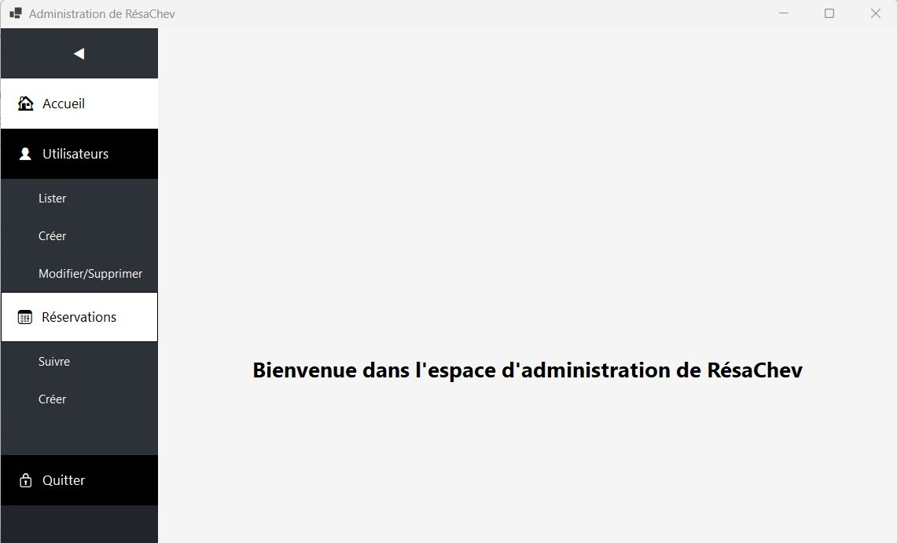
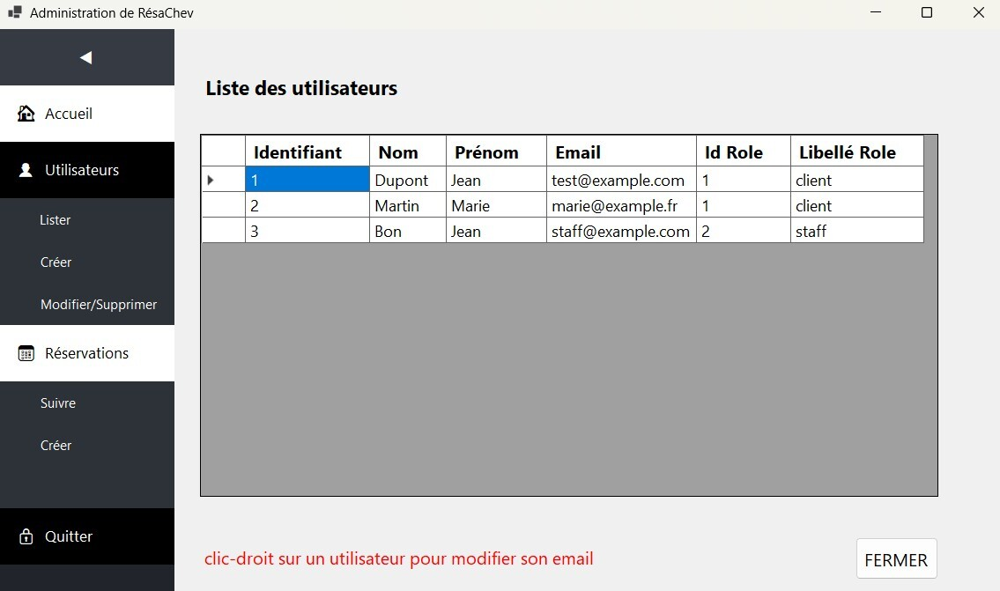
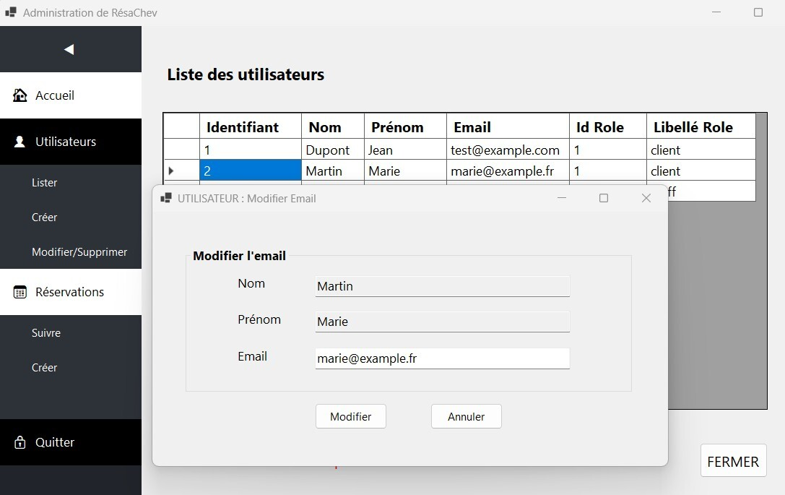
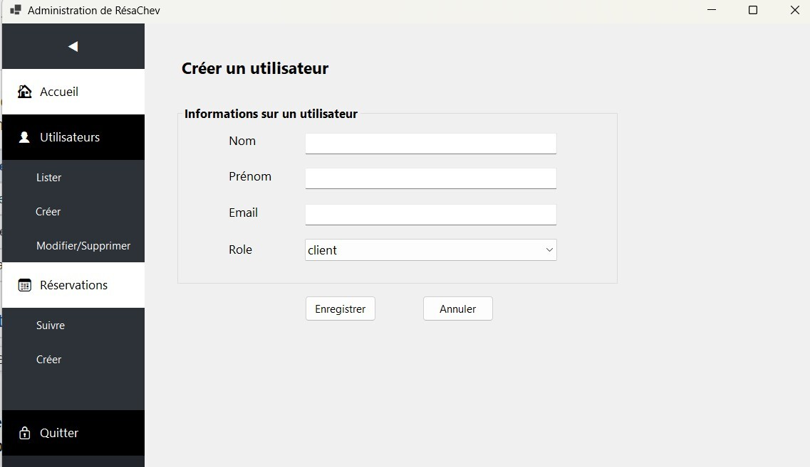
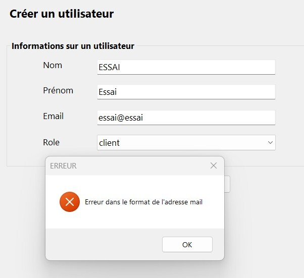
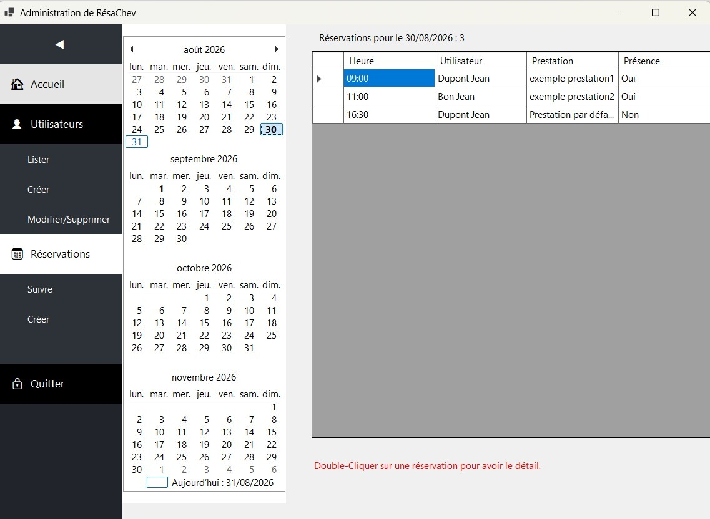
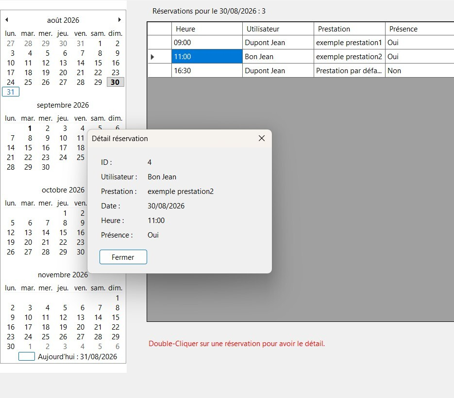
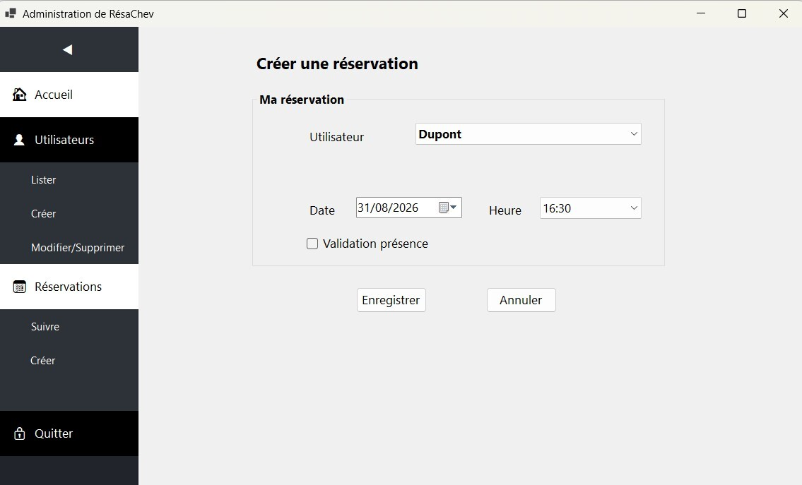

<div class="couverture">
<div class="bandeau">
<div class="sur">Dossier de spécifications</div>

# ResaChev - Application de gestion

<div class="sous">Spécifications fonctionnelles et techniques</div>
</div>

<div class="cartouche">
<table class="cartouche-tbl">
<tr><th>Projet</th><td>AP3 - ResaChev, plateforme libre de réservation de créneaux (version 1.0)</td></tr>
<tr><th>Commanditaire</th><td>1FOSIO, société de prestation informatique - Direction des systèmes d'information</td></tr>
<tr><th>Maîtrise d'œuvre</th><td>Valentin Brosseau, Carine Autret</td></tr>
<tr><th>Composant</th><td>Application de gestion pour poste de travail (dépôt <code>applicationc</code>)</td></tr>
<tr><th>Type de document</th><td>Spécifications fonctionnelles détaillées (SFD) et spécifications techniques détaillées (STD) - document d'introduction</td></tr>
<tr><th>Technologies</th><td>C# · .NET 10 · Windows Forms · Entity Framework Core 9 · Pomelo MySQL · MySQL / MariaDB</td></tr>
<tr><th>Auteur</th><td>Valentin Brosseau, Carine Autret</td></tr>
<tr><th>Version</th><td>1.0</td></tr>
<tr><th>Statut</th><td>Validé</td></tr>
<tr><th>Diffusion</th><td>Équipes de développement 1FOSIO, maîtrise d'œuvre, clients finaux</td></tr>
</table>
</div>

<div class="versions">
<h4>Historique des versions</h4>
<table class="versions-tbl">
<tr><th>Version</th><th>Auteur</th><th>Modifications</th></tr>
<tr><td>1.0</td><td>Valentin Brosseau, Carine Autret</td><td>Rédaction initiale : présentation, fonctionnalités, captures d'écran, architecture technique.</td></tr>
</table>
</div>
</div>

[[TOC]]

## 1. Introduction

### L'essentiel

1. **ResaChev** est une plateforme libre de réservation de créneaux développée par 1FOSIO ; ce dépôt est son **application de gestion**, un client lourd Windows destiné aux administrateurs de la structure.
2. Elle est développée en **C# / .NET 10 / Windows Forms** et accède à la base **directement**, sans passer par le site web ni par une API.
3. Elle couvre deux domaines : la **gestion des utilisateurs** (lister, créer, modifier l'email) et le **suivi des réservations** (calendrier, détail, création).
4. La création d'un compte déclenche l'envoi d'un **email de bienvenue** ; le mot de passe n'est jamais saisi ici, l'utilisateur le définit lui-même sur le site web.
5. L'accès aux données passe par l'**ORM Entity Framework Core**, avec des entités **générées à partir de la base existante** (approche *Database First*).
6. La **base de données est partagée** avec l'application web et l'application mobile : son schéma ne se modifie pas sans concertation.
7. Le code suit un découpage en trois couches : `Form*.cs` (présentation) → `Modele/` (accès aux données) → `Entities/` (ORM).
8. La navigation repose sur une **fenêtre unique** (`FormMenu`) à menu latéral animé, dans laquelle s'ouvrent les formulaires enfants.


### 1.1 Objet du document

Ce document présente **ResaChev**, la solution libre de réservation de créneaux développée par la société de prestation informatique **1FOSIO**, et plus précisément son **application de gestion** : un client lourd Windows utilisé par le personnel administratif de la structure pour gérer les comptes utilisateurs et suivre les réservations. Il décrit l'existant (version 1.0) qui sert de **socle technique commun** aux déclinaisons réalisées pour chaque client final. Il tient lieu à la fois de spécification fonctionnelle (ce que fait l'application, pour qui, avec quelles règles) et de spécification technique d'introduction (comment elle est construite, avec quelles technologies et quelle organisation du code).

Il s'adresse à un lecteur qui découvre le projet : chaque fonctionnalité est illustrée par une capture d'écran commentée, et la partie technique s'appuie sur les notions vues en cours (programmation orientée objet, événements Windows Forms, ORM, LINQ, couches d'accès aux données). La documentation détaillée du code se trouve dans les autres fichiers du dossier `doc/`.

### 1.2 Contexte et organisation

De nombreux secteurs d'activité (bien-être, sport, santé, coworking, loisirs…) sont confrontés au même besoin : moderniser une gestion des réservations encore souvent artisanale (tableur, papier, téléphone). Ces structures cherchent des solutions numériques fiables, rapides à mettre en place et adaptées à leur métier.

C'est dans ce contexte que **1FOSIO** a développé ResaChev, une solution libre de réservation conçue pour être **déclinée** selon les besoins de chaque client. Plutôt que de repartir de zéro pour chaque projet, la DSI de 1FOSIO a fait le choix de s'appuyer sur ResaChev comme socle technique commun, à personnaliser et enrichir selon le contexte de chaque client final.

La solution est composée de **trois applications** qui partagent une même base de données :

| Application | Technologie | Utilisateur | Rôle |
|---|---|---|---|
| Interface web | PHP / Laravel | Client | Consulter ses réservations, présenter son QR code |
| **Application de gestion** (ce document) | C# / .NET / WinForms | Administrateur | Gérer les comptes et les réservations |
| Application mobile | Flutter | Staff terrain | Consulter le planning du jour, scanner les QR codes |

Le choix d'un **client lourd** pour la gestion se justifie par l'usage : le personnel administratif travaille depuis un poste fixe du réseau interne, sur des sessions longues et des saisies répétitives, pour lesquelles les contrôles natifs de Windows (grilles, calendrier, listes déroulantes) sont plus efficaces qu'une interface web.

### 1.3 L'existant (version 1.0)

L'application (version 1.0) est développée en C# avec .NET 10 et Windows Forms. Elle présente une fenêtre unique à menu latéral rétractable, dans laquelle s'ouvrent les écrans de travail. Elle offre la **gestion des utilisateurs** (liste avec leur rôle, création avec envoi d'un email de bienvenue, modification de l'adresse email) et le **suivi des réservations** (calendrier mensuel avec les jours actifs en gras, liste des réservations d'une journée, consultation du détail, création d'une réservation). L'accès aux données s'appuie sur Entity Framework Core et le fournisseur Pomelo pour MySQL, avec des entités générées depuis la base existante. Elle s'appuie sur la base de données centralisée (MySQL / MariaDB), contrainte forte du projet : toutes les données sont hébergées sur un même serveur, partagé avec les autres composants.

### 1.4 Périmètre de ce document

**Dans le périmètre (application de gestion, ce dépôt) :**

- navigation générale : fenêtre principale, menu latéral rétractable, sous-menus ;
- liste des utilisateurs avec leur rôle ;
- création d'un utilisateur, avec validation du format de l'email et envoi d'un email de bienvenue ;
- modification de l'adresse email d'un utilisateur ;
- suivi calendaire des réservations et consultation du détail d'une réservation ;
- création d'une réservation ;
- accès aux données par ORM et organisation en couches.

**Hors périmètre** : l'espace client du site web (connexion 2FA, tableau de bord, QR code), l'application mobile du staff et son API, la gestion des paiements et l'administration du catalogue des prestations. Les évolutions demandées par 1FOSIO ne sont pas décrites ici : ce document est le point de départ de leur analyse.

### 1.5 Acteurs

| Acteur | Description | Accès dans ce projet |
|---|---|---|
| **Administrateur / gestionnaire** | Personnel administratif de la structure | Toutes les fonctions de l'application de gestion |
| **Client** (`role` = client) | Personne ayant réservé une prestation | Aucun : il est l'objet des écrans, pas leur utilisateur |
| **Staff** (`role` = staff) | Personnel de terrain | Aucun : il utilise l'application mobile |

> **Point de vigilance.** L'application ne comporte **aucun mécanisme d'authentification** : quiconque la lance accède à l'ensemble des données. Sa sécurité repose entièrement sur le contrôle d'accès au poste de travail et au réseau. Voir la section 3.7.

### 1.6 Glossaire

| Terme | Définition |
|---|---|
| **Client lourd** | Application installée sur le poste de l'utilisateur, par opposition au client léger (navigateur). Ici, un exécutable Windows. |
| **Windows Forms** | Bibliothèque graphique de .NET pour les applications de bureau Windows : fenêtres (`Form`) et contrôles (boutons, grilles, calendriers). |
| **Formulaire** (`Form`) | Fenêtre de l'application. Chaque formulaire est composé d'un fichier de code, d'un fichier généré par le concepteur visuel et d'un fichier de ressources. |
| **Événement** | Notification déclenchée par une action de l'utilisateur (clic, double-clic, chargement) et traitée par une méthode dite *gestionnaire d'événement* (`btnSave_Click`). |
| **ORM** | *Object-Relational Mapping* : bibliothèque qui fait correspondre des tables à des classes, et évite d'écrire du SQL. Ici Entity Framework Core, l'équivalent d'Eloquent côté Laravel. |
| **`DbContext`** | Classe centrale d'EF Core : elle représente la session avec la base, expose un `DbSet<T>` par table et suit les modifications des objets. |
| **`DbSet<T>`** | Collection représentant une table, sur laquelle on écrit les requêtes LINQ. |
| **LINQ** | *Language Integrated Query* : syntaxe de requête intégrée à C# (`Where`, `Select`, `OrderBy`), traduite en SQL par EF Core. |
| **Scaffolding** | Génération automatique des classes d'entités et du `DbContext` à partir d'une base **existante** (approche *Database First*). |
| **Propriété de navigation** | Propriété d'une entité qui pointe vers une entité liée (`IdroleNavigation`) ou une collection (`Reservations`) ; matérialise une clé étrangère. |
| **`Include()`** | Demande à EF Core de charger une relation en même temps que l'entité principale (jointure SQL). Sans lui, la propriété de navigation reste `null`. |
| **`BindingSource`** | Composant intermédiaire entre une source de données et un contrôle d'affichage ; connaît la ligne courante. |
| **Mail catcher** | Faux serveur SMTP qui intercepte tous les emails au lieu de les délivrer ; permet de tester les envois sans risque. |

## 2. Spécifications fonctionnelles

Cette partie décrit chaque fonctionnalité du point de vue de l'utilisateur. Les captures d'écran sont réalisées sur un jeu de données de démonstration ; elles reflètent l'état réel de l'application.

### 2.1 Fenêtre principale et navigation


<p class="legende"><strong>Figure 1</strong> : Fenêtre principale au démarrage, menu latéral déployé.</p>

L'application s'ouvre sur une fenêtre unique composée d'un **menu latéral** à gauche et d'une **zone de contenu** à droite. La barre de titre reprend le nom de la plateforme, lu en base de données dans la table `parametrage` : l'administrateur peut ainsi renommer le service sans toucher au code, exactement comme sur le site web. La zone de contenu affiche au démarrage un message d'accueil ; c'est elle qui accueillera ensuite les différents écrans de travail.


Le bouton ◀ / ▶ replie le menu de 200 à 60 pixels, ne laissant que les icônes, afin de libérer de la place pour les grilles de données. L'ouverture et la fermeture sont **animées** par un composant `Timer` qui fait varier la largeur de quelques pixels à chaque tic ; le repli ferme aussi les sous-menus ouverts.

Deux entrées de menu ouvrent un **sous-menu dépliant**, animé selon le même principe (variation de la hauteur) :

| Entrée | Sous-entrées | Écran ouvert |
|---|---|---|
| 🏠 Accueil | — | Message de bienvenue |
| 👤 Utilisateurs | Lister · Créer · Modifier/Supprimer | Liste des utilisateurs · Création d'un utilisateur · *(non implémenté)* |
| 📅 Réservations | Suivre · Créer | Suivi calendaire · Création d'une réservation |
| 🔒 Quitter | — | Ferme l'application |

Les écrans s'ouvrent **à l'intérieur** de la zone de contenu, un seul à la fois : ouvrir un nouvel écran ferme le précédent. Deux fenêtres font exception et s'ouvrent en fenêtre séparée : la modification d'email et le détail d'une réservation.

| Règle | Description |
|---|---|
| RG-NAV-1 | Le titre de la fenêtre reprend le nom de la plateforme lu dans la table `parametrage`. |
| RG-NAV-2 | Un seul écran de travail est ouvert à la fois dans la zone de contenu. |
| RG-NAV-3 | Replier le menu principal referme les sous-menus ouverts. |
| RG-NAV-4 | Cliquer sur une entrée à sous-menu alors que le menu est replié le déplie d'abord. |

### 2.2 Liste des utilisateurs


<p class="legende"><strong>Figure 2</strong> : Liste de tous les comptes avec leur rôle.</p>

L'écran affiche l'ensemble des comptes dans une grille (`DataGridView`) : identifiant, nom, prénom, email, identifiant et libellé du rôle. Le libellé (« client » ou « staff ») provient de la table `role`, jointe à la volée par l'ORM. Seules les colonnes utiles sont chargées : ni le mot de passe, ni les jetons de double authentification ne transitent jusqu'à l'écran.

Un libellé rappelle sous la grille qu'un **clic droit** sur une ligne ouvre l'entrée « Modifier Email ». C'est le point d'entrée de la seule modification prévue en version 1.0.

### 2.3 Modification de l'email d'un utilisateur


<p class="legende"><strong>Figure 3</strong> : Modification de l'adresse email d'un compte.</p>

La fenêtre rappelle le nom et le prénom du compte concerné, pour éviter toute confusion, et propose la seule saisie de l'email, présélectionnée. Le format est contrôlé avant enregistrement ; en cas d'erreur, un message le signale et la fenêtre reste ouverte. Après un enregistrement réussi, la liste des utilisateurs se **rafraîchit automatiquement** et la fenêtre se ferme.

L'adresse email étant l'identifiant de connexion au site web, cette opération n'est pas anodine : elle change la façon dont le client se connecte à son espace.

| Règle | Description |
|---|---|
| RG-EMAIL-1 | Seul l'email est modifiable ; nom et prénom sont affichés à titre d'information. |
| RG-EMAIL-2 | L'email ne peut être vide et doit respecter le format attendu. |
| RG-EMAIL-3 | La liste des utilisateurs est rafraîchie après un enregistrement réussi. |

### 2.4 Création d'un utilisateur


<p class="legende"><strong>Figure 4</strong> : Formulaire de création d'un utilisateur.</p>

Le formulaire demande le nom, le prénom, l'email et le rôle, choisi dans une liste déroulante alimentée depuis la table `role`. **Aucun mot de passe n'est saisi** : le compte est créé sans mot de passe, et l'utilisateur le définit lui-même sur le site web au moyen de la procédure « mot de passe oublié ». Ce choix évite qu'un mot de passe provisoire ne circule par email ou ne soit connu de l'administrateur.


<p class="legende"><strong>Figure 5</strong> : Erreur de format sur l'adresse email.</p>

Deux contrôles précèdent l'enregistrement : tous les champs doivent être renseignés, et l'email doit respecter le format attendu. Chaque anomalie est signalée par une boîte de dialogue, et la saisie est conservée.

L'email n'est envoyé qu'**après** un enregistrement réussi en base : un compte non créé ne génère jamais de message. Il confirme la création du compte et indique la marche à suivre pour définir un mot de passe. En environnement de projet, il est intercepté par le mail catcher et n'atteint donc aucun destinataire réel.

| Règle | Description |
|---|---|
| RG-UTIL-1 | Les quatre champs (nom, prénom, email, rôle) sont obligatoires. |
| RG-UTIL-2 | L'email doit respecter le format contrôlé par `Controleur.ValidMail()`. |
| RG-UTIL-3 | Un utilisateur est créé **sans mot de passe** ; il le définit lui-même via le site web. |
| RG-UTIL-4 | L'email de bienvenue n'est envoyé qu'après un enregistrement réussi. |

### 2.5 Suivi des réservations


<p class="legende"><strong>Figure 6</strong> : Calendrier mensuel et réservations de la journée sélectionnée.</p>

L'écran associe un **calendrier mensuel** et la liste des réservations du jour sélectionné. Les jours qui portent au moins une réservation apparaissent **en gras** dans le calendrier : l'activité du mois se lit d'un coup d'œil. Au démarrage, la journée du jour est affichée.

La grille présente, pour chaque réservation, l'heure, le nom et le prénom du client, la prestation et l'état de validation de présence (« Oui » / « Non »). Les lignes sont triées par heure croissante, de sorte que la journée se lit chronologiquement, et un libellé rappelle la date affichée ainsi que le nombre de réservations.


<p class="legende"><strong>Figure 7</strong> : Détail d'une réservation, en lecture seule.</p>

Un **double-clic** sur une ligne ouvre une fenêtre modale reprenant l'ensemble des informations de la réservation. Elle est en lecture seule : la validation de présence n'est pas modifiable ici, elle est mise à jour par l'application mobile lorsque le staff scanne le QR code du client à son arrivée. L'administrateur dispose ainsi d'une vue de contrôle sur le déroulement de la journée.

| Règle | Description |
|---|---|
| RG-RESA-1 | Les jours portant au moins une réservation apparaissent en gras dans le calendrier. |
| RG-RESA-2 | La grille affiche les réservations du seul jour sélectionné, triées par heure croissante. |
| RG-RESA-3 | Le détail d'une réservation est consultable en lecture seule, par double-clic. |
| RG-RESA-4 | La validation de présence n'est pas modifiable depuis cette application. |

### 2.6 Création d'une réservation


<p class="legende"><strong>Figure 8</strong> : Formulaire de création d'une réservation.</p>

Le formulaire permet à l'administrateur d'enregistrer une réservation prise par téléphone ou au comptoir. Il demande le client, la date (sélecteur de date), l'heure (liste déroulante des créneaux) et propose une case « Validation présence » utile lorsque la réservation est saisie a posteriori, après le passage du client.

Les créneaux proposés sont **calculés**, non stockés : la liste est construite des heures d'ouverture aux heures de fermeture, par pas de 30 minutes. C'est la même logique que la grille de créneaux du site web, appliquée ici à une simple liste déroulante.

Un message confirme l'enregistrement et le formulaire se ferme. En cas d'échec, une boîte de dialogue d'erreur est affichée et la saisie est conservée.

| Règle | Description |
|---|---|
| RG-CREA-1 | Le client est obligatoire ; sans sélection, l'enregistrement est refusé. |
| RG-CREA-2 | Les créneaux proposés vont de 09:00 à 16:30 par pas de 30 minutes. |
| RG-CREA-3 | La présence peut être validée dès la création (saisie a posteriori). |

### 2.7 Récapitulatif des fonctionnalités

| Réf. | Fonctionnalité | Acteur | Statut |
|---|---|---|---|
| F1 | Fenêtre principale, menu latéral rétractable et sous-menus | Administrateur | Livré |
| F2 | Titre de l'application lu dans `parametrage` | Administrateur | Livré |
| F3 | Liste des utilisateurs avec leur rôle | Administrateur | Livré |
| F4 | Création d'un utilisateur (validation du format d'email) | Administrateur | Livré |
| F5 | Envoi d'un email de bienvenue à la création | Administrateur | Livré |
| F6 | Modification de l'adresse email d'un utilisateur | Administrateur | Livré |
| F7 | Suivi calendaire des réservations (jours actifs en gras) | Administrateur | Livré |
| F8 | Détail d'une réservation en lecture seule | Administrateur | Livré |
| F9 | Création d'une réservation | Administrateur | Livré - partiel |
| F10 | Choix de la prestation à la création d'une réservation | Administrateur | Évolution prioritaire |
| F11 | Contrôle de collision des créneaux (double réservation) | Administrateur | Évolution prioritaire |
| F12 | Modification et suppression d'un utilisateur | Administrateur | Évolution (entrée de menu présente) |
| F13 | Authentification de l'administrateur au lancement | Administrateur | Évolution prioritaire |
| F14 | Externalisation de la chaîne de connexion | — | Évolution prioritaire |
| F15 | Administration du catalogue des prestations et des paiements | Administrateur | Évolution |

## 3. Spécifications techniques

### 3.1 Stack technique

| Couche | Technologie | Justification |
|---|---|---|
| Langage | C# 13 | Langage étudié en seconde année, typage fort, outillage complet |
| Plateforme | .NET 10, cible `net10.0-windows` | Version courante à support long ; la cible Windows est imposée par Windows Forms |
| Interface graphique | Windows Forms | Concepteur visuel, contrôles riches (grille, calendrier) adaptés à la saisie administrative sur poste fixe |
| Accès aux données | Entity Framework Core 9 | ORM standard de .NET : requêtes LINQ typées, requêtes paramétrées, pas de SQL à écrire |
| Fournisseur BDD | `Pomelo.EntityFrameworkCore.MySql` 9.0 | Fournisseur MySQL / MariaDB de référence pour EF Core |
| Base de données | MySQL / MariaDB, serveur mutualisé partagé | Contrainte du projet : données centralisées sur un même serveur |
| Emails | `System.Net.Mail.SmtpClient` vers un mail catcher | Envoi simple sans dépendance externe, intercepté en environnement de test |

Aucune bibliothèque graphique tierce n'est utilisée : l'interface repose uniquement sur les contrôles standards de Windows Forms.

### 3.2 Architecture en couches

L'application applique une séparation **présentation / accès aux données / entités**, transposition en C# du découpage MVC vu en cours :

```
   Formulaires (présentation)              Modele/ (accès données)        Entities/ (ORM)
 ┌──────────────────────────────┐      ┌────────────────────────┐    ┌───────────────────┐
 │ FormMenu, FormListerUtil,    │ ───▶ │ ModeleUtilisateur      │───▶│ DbSet<Utilisateur>│──▶ MySQL
 │ FormCreerUtil, FormModif...  │      │ ModeleReservation      │    │ DbSet<Reservation>│
 │ FormSuivreResa, FormCreerResa│ ◀─── │ ConnexionBD            │◀───│ Ap3BdReservation  │
 └──────────────────────────────┘      └────────────────────────┘    │      Context      │
              │                                                       └───────────────────┘
              └──▶ Controleur (validation email, envoi SMTP)
```

**Les formulaires** (`Form*.cs`) affichent les données et réagissent aux événements de l'utilisateur. Ils ne contiennent **aucune requête** : ils appellent les méthodes statiques de `Modele/` et se contentent d'exploiter le résultat.

**La couche modèle** (`Modele/`) regroupe toutes les requêtes LINQ / EF Core. Chaque méthode capture les exceptions, affiche un message et retourne un booléen de succès, de sorte que le formulaire appelant reste simple.

**Les entités** (`Entities/`) sont générées par scaffolding : une classe par table, plus le `DbContext`. Elles ne sont jamais modifiées à la main.

**`Controleur`** est une classe statique portant les fonctions transversales, sans lien avec la base : validation du format d'un email, envoi d'un message SMTP.

**Pourquoi ces choix techniques ?** Plusieurs partis pris ont une raison pédagogique : la couche `Modele/` est **écrite à la main** plutôt que d'appeler EF Core directement depuis les formulaires, afin que la séparation des responsabilités soit visible ; les entités sont **générées depuis la base** (*Database First*) parce que le schéma est imposé et partagé avec les deux autres applications, et non défini par cette application ; enfin l'interface s'appuie uniquement sur les **contrôles standards**, pour que chaque comportement (animation du menu, liaison de données, menu contextuel) reste lisible dans le code du projet.

### 3.3 Organisation des dossiers

```
applicationc/
├── AP3_applicationC.slnx          Solution (format slnx)
└── AP3_applicationC/
    ├── AP3_applicationC.csproj    Cible net10.0-windows, paquets NuGet
    ├── Program.cs                 Point d'entrée : init BDD puis FormMenu
    ├── Controleur.cs              Validation d'email, envoi SMTP
    ├── Entities/                  Entités et DbContext générés (scaffolding)
    ├── Modele/                    ConnexionBD, ModeleUtilisateur, ModeleReservation
    ├── Form*.cs                   Code des formulaires
    ├── Form*.Designer.cs          Code généré par le concepteur visuel
    ├── Form*.resx                 Ressources des formulaires
    └── doc/                       Documentation, captures, outils de génération
```

Chaque formulaire est composé de trois fichiers : le code que l'on écrit (`FormXxx.cs`), le code **généré** par le concepteur visuel (`FormXxx.Designer.cs`, à ne jamais modifier à la main) et les ressources (`FormXxx.resx`).

### 3.4 Base de données et ORM

La base est **partagée** entre les trois applications : son schéma ne peut être modifié sans concertation entre les équipes. Les noms de tables et de colonnes sont en français, au singulier et en minuscules ; les clés primaires et étrangères sont préfixées par `id`. La structure est fournie sous deux formes complémentaires : le **modèle conceptuel** (`AP3_MCD_Initial.mcd`) et le **script SQL** de déploiement (`AP3_BD_reservation.sql`), tous deux disponibles sur Moodle. Cette application ne crée pas le schéma : elle se **connecte à une base existante**.


| Table | Rôle | Usage dans cette application |
|---|---|---|
| `role` | Type d'utilisateur | Alimente la liste déroulante des rôles et la colonne « Libellé Role » |
| `utilisateur` | Comptes utilisateurs | Liste, création, modification de l'email |
| `prestation` | Catalogue des prestations | Lue pour l'affichage du libellé dans le suivi ; pas encore administrable |
| `reservation` | Rendez-vous d'un client | Suivi calendaire, détail, création |
| `parametrage` | Configuration de la plateforme | Lue au démarrage pour le titre de la fenêtre |
| `cache`, `jobs`, `sessions`, `migrations`, `personal_access_tokens`… | Tables techniques de Laravel | Entités générées par le scaffolding, **à ne jamais manipuler** |

**Le `DbContext`.** `Ap3DemoContext` est la classe centrale d'EF Core : elle représente la session avec la base, expose un `DbSet<T>` par table et décrit dans `OnModelCreating()` la correspondance entre propriétés C# et colonnes SQL, le schéma ne suivant pas les conventions de nommage d'EF Core.

```csharp
modelBuilder.Entity<Reservation>(entity =>
{
    entity.HasKey(e => e.Idreservation).HasName("PRIMARY");
    entity.ToTable("reservation");

    entity.Property(e => e.Heuredebut).HasColumnType("time").HasColumnName("heuredebut");

    // Clé étrangère et propriété de navigation
    entity.HasOne(d => d.IdutilisateurNavigation).WithMany(p => p.Reservations)
          .HasForeignKey(d => d.Idutilisateur)
          .HasConstraintName("reservation_idutilisateur_foreign");
});
```

Ce sont exactement les mêmes informations que dans les modèles Eloquent côté web (`$table`, `$primaryKey`, `belongsTo`, `hasMany`), exprimées avec l'API *fluent* d'EF Core.

**Le scaffolding.** Les entités sont générées à partir de la base existante, avec l'outil `dotnet ef` :

```bash
dotnet ef dbcontext scaffold \
  "server=127.0.0.1;port=3306;user=root;database=ap3_bd_reservation" \
  Pomelo.EntityFrameworkCore.MySql --output-dir Entities --force
```

`--force` **écrase** le contenu de `Entities/` : aucune modification manuelle ne doit y être apportée. Les classes étant déclarées `partial`, toute méthode métier s'ajoute dans un autre fichier portant le même nom de classe, hors du dossier régénéré.

**Les requêtes.** Toutes les lectures passent par LINQ, donc par des requêtes paramétrées :

```csharp
// Liste des utilisateurs avec leur rôle (jointure explicite)
public static List<Utilisateur> listeUtilisateurs()
    => ConnexionBD.MonModel.Utilisateurs.Include(x => x.IdroleNavigation).ToList();
```

`Include()` est l'équivalent du chargement de relation `with()` d'Eloquent : sans lui, la propriété de navigation reste `null`, EF Core n'activant pas le chargement paresseux par défaut.

**Les écritures** suivent toujours le même schéma : modifier l'objet suivi par le contexte, puis appeler `SaveChanges()`. En cas d'exception, `ChangeTracker.Clear()` abandonne les modifications en attente, sans quoi le contexte tenterait de les rejouer au prochain enregistrement.

### 3.5 Cycle de vie et connexion à la base

```
Program.Main()
    │
    ├─ ApplicationConfiguration.Initialize()
    ├─ ConnexionBD.init()          ← new Ap3BdReservationContext()   ─────┐
    └─ Application.Run(new FormMenu())                                    │
            │                                                             │
            ├─ lecture de parametrage → titre de la fenêtre ──────────────┤
            ├─ openChildForm(FormListerUtil) → ModeleUtilisateur ─────────┤ contexte
            ├─ openChildForm(FormSuivreResa) → ModeleReservation ─────────┤ statique
            └─ … jusqu'à Application.Exit()                               │ partagé
                                                                          ┘
```

Le `DbContext` est créé **une seule fois** au démarrage et exposé par une propriété statique `ConnexionBD.MonModel`, utilisée par toute la couche modèle.

### 3.6 Sécurité

| Mesure | Situation dans le projet |
|---|---|
| Injection SQL | Couverte : toutes les requêtes passent par LINQ / EF Core, donc paramétrées ; aucun SQL n'est concaténé |
| Exposition des données sensibles | Couverte à l'affichage : la liste des utilisateurs ne charge ni le mot de passe ni les jetons 2FA |
| Gestion des mots de passe | Couverte par conception : l'application n'en manipule aucun ; l'utilisateur définit le sien sur le site web |
| Emails de test | Couverte : le mail catcher intercepte tous les envois, aucun message n'atteint un destinataire réel |
| **Authentification** | **Point de vigilance** : aucune. Quiconque lance l'exécutable accède à toutes les données |
| **Traçabilité** | **Point de vigilance** : aucune trace des créations et modifications ; impossible de savoir qui a modifié un email |
| Confidentialité des données personnelles | L'application affiche des données à caractère personnel (nom, email) : l'accès au poste doit être contrôlé et la session verrouillée en cas d'absence |

En l'état, la sécurité repose **entièrement** sur le contrôle d'accès au poste de travail et au réseau interne. C'est acceptable pour une version de développement, pas pour une mise en production.

### 3.7 Tests

La version 1.0 ne comporte **pas de tests automatisés**. La validation est manuelle, à partir du scénario de recette suivant :

| # | Scénario | Résultat attendu |
|---|---|---|
| 1 | Lancer l'application | La fenêtre s'ouvre, le titre reprend le nom de la plateforme |
| 2 | Replier puis déplier le menu | Animation fluide, sous-menus refermés au repli |
| 3 | Utilisateurs → Lister | La grille affiche tous les comptes avec leur libellé de rôle |
| 4 | Utilisateurs → Créer, champ vide | Message « Veuillez saisir tous les champs. » |
| 5 | Utilisateurs → Créer, email `toto@` | Message d'erreur de format, aucun enregistrement |
| 6 | Utilisateurs → Créer, saisie valide | Confirmation, ligne ajoutée en base, email visible dans le mail catcher |
| 7 | Clic droit sur une ligne → Modifier Email | La fenêtre s'ouvre pré-remplie avec le bon compte |
| 8 | Enregistrer un email valide | La liste se rafraîchit avec la nouvelle adresse |
| 9 | Réservations → Suivre | Les jours actifs apparaissent en gras ; la journée du jour est affichée |
| 10 | Sélectionner un autre jour | La grille et le compteur se mettent à jour |
| 11 | Double-clic sur une réservation | La fenêtre de détail s'ouvre avec les bonnes valeurs |
| 12 | Réservations → Créer sans client | Message « Veuillez sélectionner un utilisateur. » |

La mise en place de tests unitaires sur la couche `Modele/` (avec xUnit ou MSTest, sur une base de test) est une évolution attendue. 

## 4. Premier démarrage

### 4.1 Environnement mis à disposition

L'application est destinée à un poste de travail Windows du réseau interne, connecté au **serveur de base de données mutualisé** (MariaDB) sur lequel chaque équipe demande la création de ses comptes et de leurs droits. Une **plateforme e-mail de type mail catcher** intercepte tous les messages envoyés par les applications du projet : c'est elle qui reçoit les emails de bienvenue produits à la création d'un utilisateur. Les adresses de ces services, du site existant et des dépôts Git figurent dans le descriptif du projet.

### 4.2 Prérequis sur le poste de développement

- **Windows 10 ou 11** : la cible `net10.0-windows` et Windows Forms ne compilent ni ne s'exécutent sur Linux ou macOS ;
- **SDK .NET 10** (`dotnet --version` doit retourner une version 10.x) ;
- **Visual Studio 2022** ou plus récent, avec la charge de travail « Développement .NET Desktop » (ou JetBrains Rider) ;
- un accès au serveur **MariaDB** mutualisé, ou une base MySQL locale, contenant le schéma `ap3_demo` ;
- pour les emails : le **mail catcher** `mail.dombtsig.local:1025`.

### 4.3 Installation

Le projet est récupéré depuis Git ; les paquets NuGet ne sont pas versionnés et sont réinstallés à la première compilation.

```bash
git clone <url-du-depot> applicationc
cd applicationc

dotnet restore     # télécharge EF Core, les outils EF et le fournisseur Pomelo
dotnet build       # compile la solution
```

Sous Visual Studio, ouvrir `AP3_applicationC.slnx` : la restauration des paquets est automatique.

### 4.4 Lancement

```bash
dotnet run --project AP3_applicationC
```

Sous Visual Studio : **F5** (avec débogueur) ou **Ctrl+F5** (sans).

Si l'application se ferme immédiatement au démarrage, les causes les plus fréquentes sont : serveur MySQL injoignable (chaîne de connexion erronée), schéma absent, ou table `parametrage` vide.

### 4.5 Commandes utiles

| Commande | Usage |
|---|---|
| `dotnet tool install --global dotnet-ef` | Installe l'outil de ligne de commande EF Core |
| `dotnet ef dbcontext scaffold "<connexion>" Pomelo.EntityFrameworkCore.MySql --output-dir Entities --force` | Régénère les entités depuis la base |

