<div class="couverture">
<div class="bandeau">
<div class="sur">Dossier de spécifications</div>

# ResaChev - Interface web

<div class="sous">Spécifications fonctionnelles et techniques (SFD / STD)</div>
</div>

<div class="cartouche">
<table class="cartouche-tbl">
<tr><th>Projet</th><td>AP3 - ResaChev, plateforme libre de réservation de créneaux (version 1.0)</td></tr>
<tr><th>Commanditaire</th><td>1FOSIO, société de prestation informatique - Direction des systèmes d'information</td></tr>
<tr><th>Maîtrise d'œuvre</th><td>Valentin Brosseau, Carine Autret</td></tr>
<tr><th>Composant</th><td>Interface web client et API mobile (dépôt <code>front</code>)</td></tr>
<tr><th>Type de document</th><td>Spécifications fonctionnelles détaillées (SFD) et spécifications techniques détaillées (STD) - document d'introduction</td></tr>
<tr><th>Technologies</th><td>PHP 8 · Laravel · MySQL / MariaDB · Bootstrap 5 · Vue.js 3 · Laravel Sanctum</td></tr>
<tr><th>Auteur</th><td>Valentin Brosseau</td></tr>
<tr><th>Version</th><td>1.0</td></tr>
<tr><th>Statut</th><td>Validé</td></tr>
<tr><th>Diffusion</th><td>Équipes de développement 1FOSIO, maîtrise d'œuvre, clients finaux</td></tr>
</table>
</div>

<div class="versions">
<h4>Historique des versions</h4>
<table class="versions-tbl">
<tr><th>Version</th><th>Auteur</th><th>Modifications</th></tr>
<tr><td>1.0</td><td>Valentin Brosseau</td><td>Rédaction initiale : présentation, fonctionnalités, captures d'écran, architecture technique.</td></tr>
</table>
</div>
</div>

[[TOC]]

## 1. Introduction

### L'essentiel en dix points

1. **ResaChev** est une plateforme libre de réservation de créneaux développée par 1FOSIO ; ce dépôt est son **interface web** (PHP / Laravel) et l'**API** de l'application mobile du staff.
2. Un **client** se connecte avec email + mot de passe, puis un **code à 6 chiffres reçu par email** (2FA).
3. Son **tableau de bord** montre sa prochaine réservation et une **grille de créneaux** sur 7 jours, mise à jour par Vue.js sans recharger la page.
4. Il présente à l'accueil un **QR code** qui encode l'identifiant de sa réservation ; le staff le scanne pour valider sa présence.
5. Les **créneaux ne sont pas stockés** : ils sont calculés à partir des paramètres (ouverture, fermeture, durée).
6. La **base de données** est partagée avec d'autres applications : son schéma ne se modifie pas sans concertation.
7. Le code suit le **MVC de Laravel** : `routes/web.php` → `app/Http/Controllers` → `app/Models` → `resources/views`.
8. Les routes `/espace/*` sont protégées par le **middleware `auth`**, l'API par `auth:sanctum`.
9. Pour démarrer : `composer install`, `.env`, `php artisan migrate:fresh --seed`, `php artisan serve` (section 4).
10. Si vous ne lisez que deux sections techniques : **3.2 (parcours d'une requête)** et **3.4 (base de données)**.

### 1.1 Objet du document

Ce document présente **ResaChev**, la solution libre de réservation de créneaux développée par la société de prestation informatique **1FOSIO**, et plus précisément son **interface web** destinée aux clients ainsi que l'**API REST** qu'elle intègre à destination de l'application mobile du personnel. Il décrit l'existant (version 1.0) qui sert de **socle technique commun** aux déclinaisons réalisées pour chaque client final. Il tient lieu à la fois de spécification fonctionnelle (ce que fait l'application, pour qui, avec quelles règles) et de spécification technique d'introduction (comment elle est construite, avec quelles technologies et quelle organisation du code).

Il s'adresse à un lecteur qui découvre le projet : chaque fonctionnalité est illustrée par une capture d'écran commentée, et la partie technique s'appuie sur les notions vues en cours (architecture MVC, routeur, contrôleurs, ORM Eloquent, templates Blade, middlewares, migrations). La documentation détaillée du code se trouve dans les autres fichiers du dossier `doc/`.

### 1.2 Contexte et organisation

De nombreux secteurs d'activité (bien-être, sport, santé, coworking, loisirs…) sont confrontés au même besoin : moderniser une gestion des réservations encore souvent artisanale (tableur, papier, téléphone). Ces structures cherchent des solutions numériques fiables, rapides à mettre en place et adaptées à leur métier.

C'est dans ce contexte que **1FOSIO** a développé ResaChev, une solution libre de réservation conçue pour être **déclinée** selon les besoins de chaque client. Plutôt que de repartir de zéro pour chaque projet, la DSI de 1FOSIO a fait le choix de s'appuyer sur ResaChev comme socle technique commun, à personnaliser et enrichir (vocabulaire, services et options associés aux réservations, parcours utilisateur, contraintes particulières) selon le contexte de chaque client final.

Le socle est décliné, par des équipes de trois développeurs-concepteurs encadrées par la maîtrise d'œuvre de 1FOSIO, pour des clients finaux de secteurs variés : thalasso, salle de sport, club de padel, cabinet de kinésithérapie, coworking, salle de jeux, studio de répétition. Tous partagent le même besoin de base (consulter des disponibilités, réserver, être accueilli rapidement) mais avec un vocabulaire, des prestations et des options qui leur sont propres.

Le présent document décrit le **socle commun** : les captures et le jeu de données de démonstration (prestations « Balade à cheval », « Cours particulier ») sont des exemples génériques, que chaque équipe remplace par le vocabulaire et les prestations de son client.

### 1.3 L'existant (version 1.0)

L'application web (version 1.0) est développée en PHP avec le framework Laravel, HTML, CSS et JavaScript (Vue.js). Elle offre un **mode public** (page d'accueil non personnalisée, connexion par e-mail et mot de passe avec double authentification par code OTP envoyé par e-mail, mot de passe oublié) et un **mode inscrit** (tableau de bord avec le prochain créneau réservé et une vue calendrier des créneaux, gestion du profil, affichage du QR code). Elle intègre également une **API REST**, documentée sur la page `api-doc` accessible librement, utilisée par l'application mobile du personnel (connexion, planning, scan du QR code). Elle s'appuie sur une base de données centralisée (MySQL / MariaDB), contrainte forte du projet : toutes les données sont hébergées sur un même serveur.

### 1.4 Périmètre de ce document

**Dans le périmètre (application web, ce dépôt) :**

- authentification par email et mot de passe, renforcée par une **double authentification (2FA) par email** ;
- procédure de mot de passe oublié avec lien de réinitialisation envoyé par email ;
- tableau de bord du client : prochaine réservation et grille hebdomadaire des créneaux ;
- consultation et modification du profil ;
- affichage et impression du billet QR code ;
- API REST sécurisée (Laravel Sanctum) consommée par l'application mobile du personnel ;
- documentation technique et tests automatisés.

**Hors périmètre** : la création des réservations et des utilisateurs (application de gestion) et l'application mobile elle-même ; seule l'API qu'elle consomme est décrite ici. Les évolutions demandées par 1FOSIO ne sont pas décrites ici : ce document est le point de départ de leur analyse.

### 1.5 Acteurs

| Acteur | Description | Accès dans ce projet |
|---|---|---|
| **Visiteur** | Internaute non authentifié | Page d'accueil, connexion, mot de passe oublié, documentation de l'API |
| **Client** (`role` = client) | Personne ayant réservé une prestation | Espace connecté : tableau de bord, profil, QR code |
| **Staff** (`role` = staff) | Personnel de terrain | API mobile uniquement, via l'application mobile |

### 1.6 Glossaire

| Terme | Définition |
|---|---|
| **Créneau** | Plage horaire réservable, calculée à partir des heures d'ouverture / fermeture et de la durée paramétrée. Les créneaux ne sont pas stockés en base. |
| **Réservation** | Association d'un client, d'une prestation, d'une date et d'une heure de début. Créée par la structure, en dehors de l'application web. |
| **OTP** | *One-Time Password* : code à usage unique (6 chiffres) envoyé par e-mail lors de la connexion. |
| **Mail catcher** | Faux serveur SMTP qui intercepte tous les e-mails envoyés au lieu de les délivrer ; permet de tester la 2FA sans risque. |
| **2FA** | Double authentification : après le mot de passe, un code à usage unique reçu par email est exigé. |
| **Session** | Données conservées côté serveur entre deux requêtes d'un même navigateur (identifiées par un cookie) ; c'est ce qui permet de rester connecté. |
| **CSRF** | *Cross-Site Request Forgery* : attaque qui fait soumettre un formulaire à l'insu de l'utilisateur ; Laravel s'en protège avec le jeton `@csrf`. |
| **Middleware** | Code exécuté avant le contrôleur pour filtrer la requête (ex. : `auth` redirige les visiteurs non connectés). |
| **JSON** | Format texte d'échange de données, lu nativement par JavaScript ; utilisé par la grille des créneaux et par l'API. |
| **Bearer token** | Jeton transmis dans l'en-tête HTTP `Authorization: Bearer <jeton>` pour authentifier chaque appel à l'API. |
| **Validation de présence** | Lecture du QR code du client par le staff à son arrivée ; l'application mobile appelle l'API pour marquer la réservation comme honorée. |
| **Token Sanctum** | Jeton d'API délivré à l'application mobile après authentification, transmis dans l'en-tête `Authorization: Bearer`. |

## 2. Spécifications fonctionnelles

Cette partie décrit chaque fonctionnalité du point de vue de l'utilisateur. Les captures d'écran sont produites automatiquement sur un jeu de données de démonstration (client « Jean Dupont ») ; elles reflètent donc l'état réel de l'application.

### 2.1 Page d'accueil

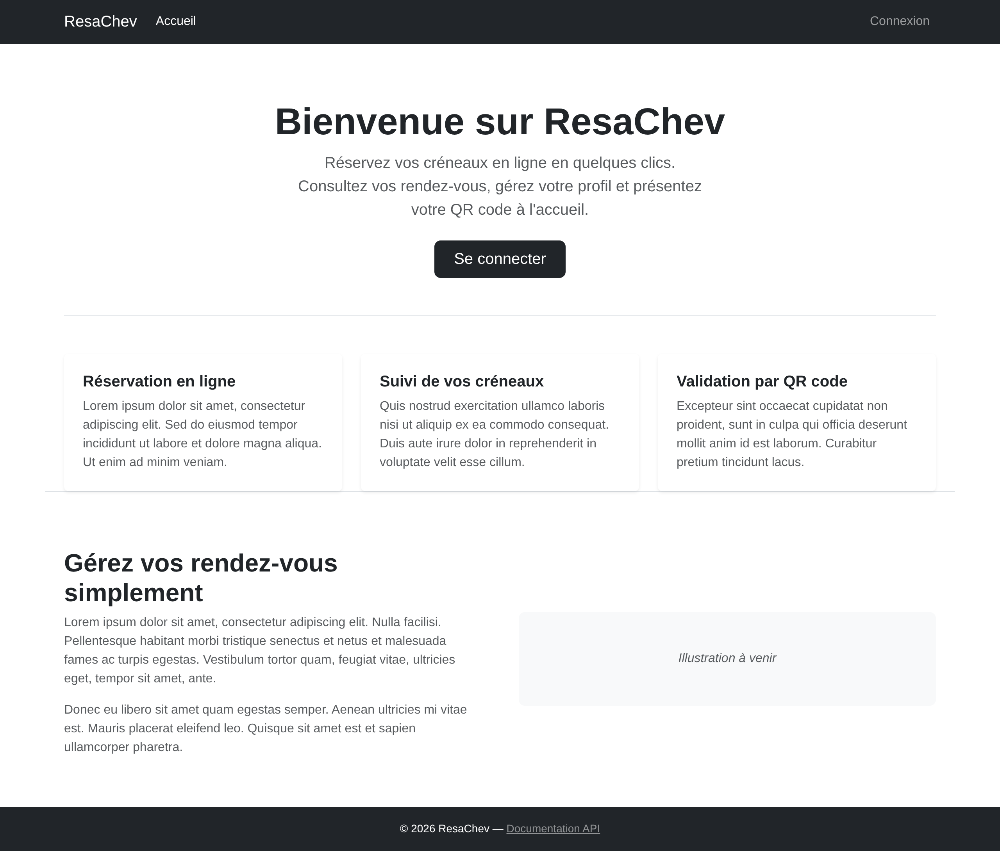
<p class="legende"><strong>Figure 1</strong> : Page d'accueil vue par un visiteur.</p>

La page d'accueil est une vitrine minimale. Son bandeau reprend le nom de la plateforme, lu en base de données dans la table `parametrage` (paramètre `nomPlateforme`) : l'administrateur peut ainsi renommer le service sans toucher au code. Trois cartes résument les fonctionnalités offertes au client (réservation en ligne, suivi des rendez-vous, validation par QR code). Le bouton principal mène au formulaire de connexion ; si l'utilisateur est déjà authentifié, il est remplacé par « Mon compte » grâce à la directive Blade `@auth`. Le pied de page, commun à toutes les pages via le layout `layouts/app.blade.php`, donne accès à la documentation de l'API mobile.

### 2.2 Connexion avec double authentification

L'authentification se déroule en **deux étapes**, conformément aux recommandations de l'OWASP contre le vol de mots de passe : l'utilisateur prouve d'abord ce qu'il **sait** (son mot de passe), puis ce qu'il **possède** (l'accès à sa boîte email). Tant que le code n'est pas validé, aucune session n'est ouverte.

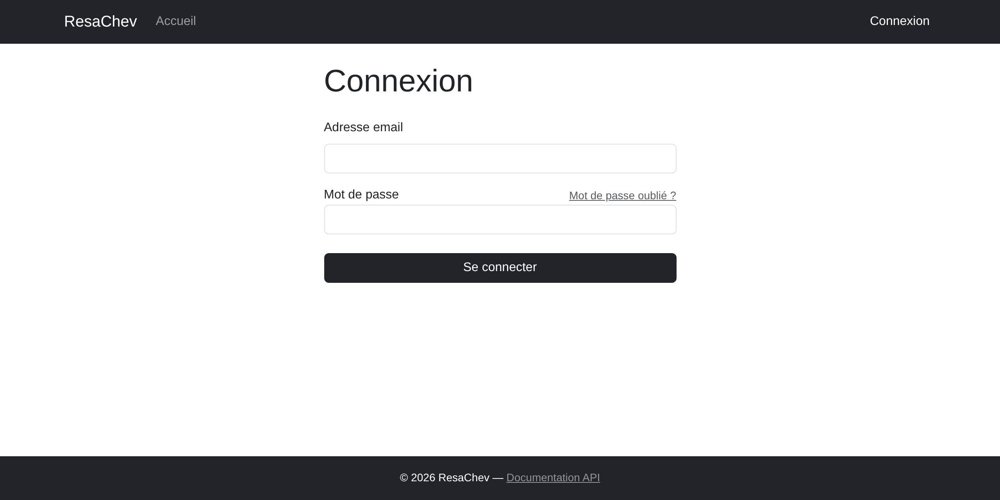
<p class="legende"><strong>Figure 2</strong> : Étape 1 : formulaire de connexion.</p>

Le formulaire demande l'adresse email et le mot de passe. Il est protégé contre les attaques CSRF par le jeton `@csrf` de Laravel, et les données sont validées côté serveur (`email` obligatoire et au bon format, `motpasse` obligatoire). Le lien « Mot de passe oublié ? » lance la procédure de réinitialisation décrite en 2.3.

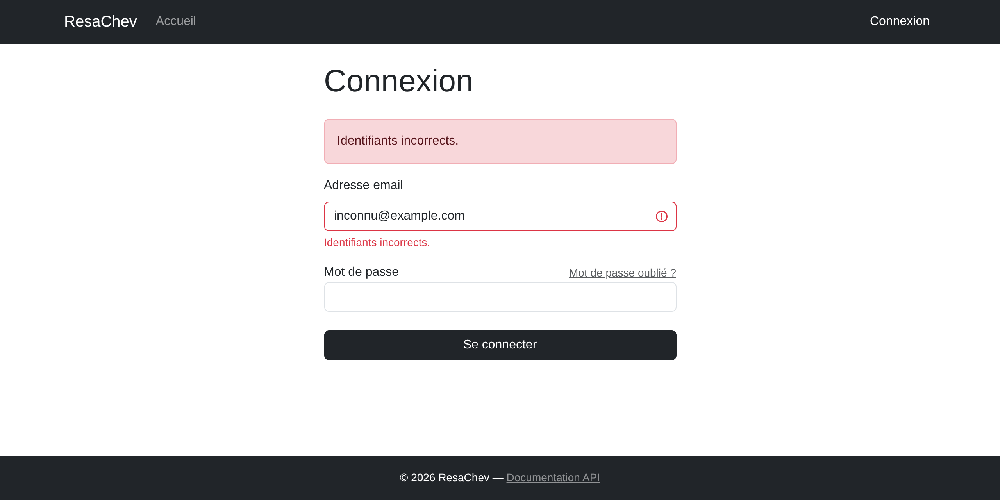
<p class="legende"><strong>Figure 3</strong> : Étape 1 : identifiants incorrects.</p>

En cas d'échec, le contrôleur renvoie l'utilisateur sur le formulaire avec `back()->withErrors()` : le message est volontairement **générique** (« identifiants incorrects »), afin de ne pas révéler si l'adresse email existe dans la base. L'email saisi est conservé dans le champ grâce à `old('email')`, comme vu dans le TP sur l'authentification manuelle ; le mot de passe, lui, n'est jamais réaffiché.

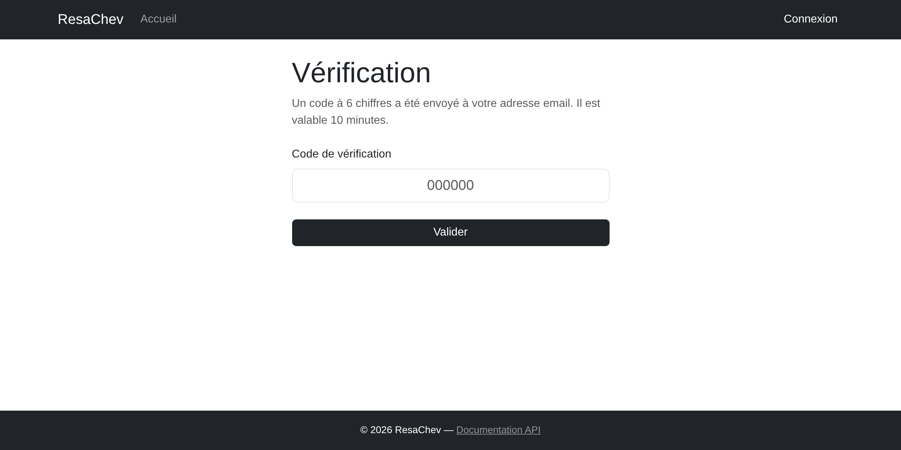
<p class="legende"><strong>Figure 4</strong> : Étape 2 : saisie du code reçu par email.</p>

Une fois le couple email / mot de passe reconnu, l'application génère un code aléatoire à 6 chiffres, l'enregistre avec sa date d'expiration (10 minutes) dans la table `utilisateur`, l'envoie par email et redirige vers cette page. L'adresse email est mémorisée en session le temps de la vérification : un accès direct à cette URL sans être passé par l'étape 1 renvoie vers le formulaire de connexion. Un code faux ou expiré affiche une erreur et laisse l'utilisateur ressaisir ; un code valide est immédiatement effacé (usage unique), puis `Auth::login()` ouvre la session et la régénère.

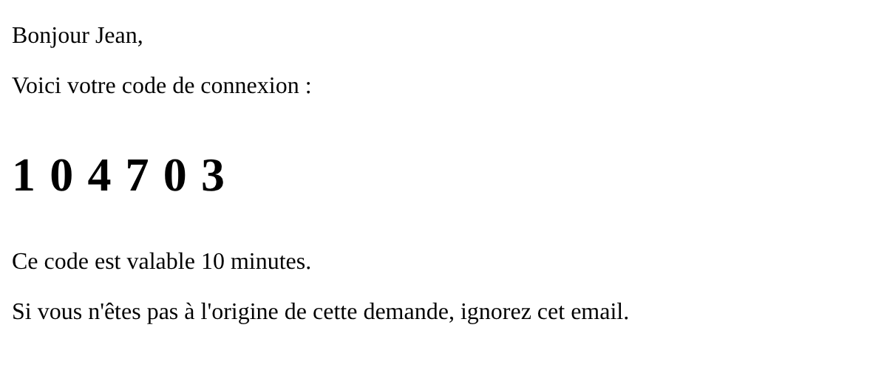
<p class="legende"><strong>Figure 5</strong> : Email reçu par l'utilisateur avec son code de connexion.</p>

L'email est rendu à partir d'un template Blade dédié (`emails/code2fa.blade.php`) et envoyé via la classe utilitaire `EmailHelpers`, point d'entrée unique pour tous les envois de l'application. Le message rappelle la durée de validité du code et invite l'utilisateur à ignorer le message s'il n'est pas à l'origine de la demande.

**Règles de gestion :**

| Règle | Description |
|---|---|
| RG-AUTH-1 | Le code 2FA est aléatoire, sur 6 chiffres, et expire 10 minutes après sa génération. |
| RG-AUTH-2 | Un code n'est utilisable qu'une seule fois : il est effacé dès la connexion réussie. |
| RG-AUTH-3 | La session est régénérée après connexion (protection contre la fixation de session). |
| RG-AUTH-4 | Le message d'erreur de connexion ne distingue pas « email inconnu » et « mot de passe incorrect ». |
| RG-AUTH-5 | La 2FA peut être désactivée par configuration (`AUTH_2FA_ENABLED=false`) en développement uniquement. |
| RG-AUTH-6 | Toute page de l'espace connecté redirige un visiteur non authentifié vers `/connexion`. |

### 2.3 Mot de passe oublié

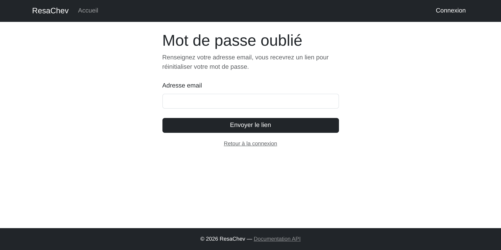
<p class="legende"><strong>Figure 6</strong> : Demande de réinitialisation du mot de passe.</p>

L'utilisateur saisit son adresse email. Quelle que soit l'existence du compte, le même message de confirmation s'affiche : un attaquant ne peut pas utiliser ce formulaire pour découvrir des adresses valides. Si le compte existe, un jeton aléatoire de 64 caractères est généré, stocké avec une expiration de 30 minutes, et un lien contenant ce jeton est envoyé par email. Le lien ouvre un second formulaire (nouveau mot de passe et confirmation, 8 caractères minimum) ; après enregistrement, le jeton est invalidé et l'utilisateur est renvoyé vers la connexion.

| Règle | Description |
|---|---|
| RG-MDP-1 | Le message affiché après la demande est identique que l'email existe ou non. |
| RG-MDP-2 | Le jeton de réinitialisation fait 64 caractères aléatoires, est valable 30 minutes et à usage unique. |
| RG-MDP-3 | Le nouveau mot de passe doit contenir au moins 8 caractères et être confirmé (règle `confirmed`). |

### 2.4 Tableau de bord du client

Le tableau de bord est la page centrale de l'espace connecté. Il est composé de deux blocs : une carte « Prochaine réservation » rendue côté serveur par Blade, et une grille de créneaux rendue côté navigateur par Vue.js.

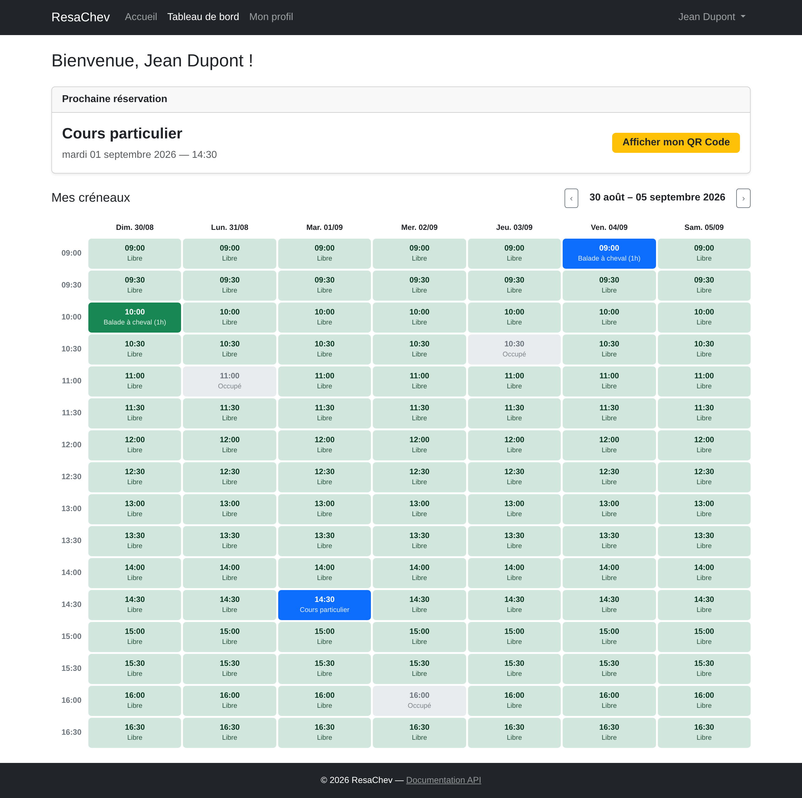
<p class="legende"><strong>Figure 7</strong> : Tableau de bord du client connecté.</p>

En haut, la carte affiche la prestation, la date et l'heure du prochain rendez-vous, obtenus par la relation `prochaineReservation()` du modèle `Utilisateur` (filtrée sur les dates à venir). Le bouton « Afficher mon QR Code » mène au billet ; il est remplacé par un badge « Présence validée » une fois la présence du client validée. En l'absence de réservation future, un message l'indique. En dessous, la grille « Mes créneaux » couvre 7 jours (de la veille à J+5) et toutes les heures d'ouverture, ici de 09:00 à 17:00 par pas de 30 minutes. Chaque cellule porte un statut coloré : vert clair pour un créneau libre, gris pour un créneau pris par un autre client (sans aucune information sur celui-ci), bleu pour une réservation du client connecté, vert foncé lorsque sa présence a été validée. Un clic sur l'une de ses réservations ouvre le QR code.

| Statut | Couleur | Signification |
|---|---|---|
| `libre` | vert clair | Aucune réservation sur ce créneau |
| `occupe` | gris | Réservé par un autre client |
| `ma_reservation` | bleu | Réservé par le client connecté, présence non encore validée |
| `valide` | vert foncé | Réservé par le client connecté, présence validée par le personnel |

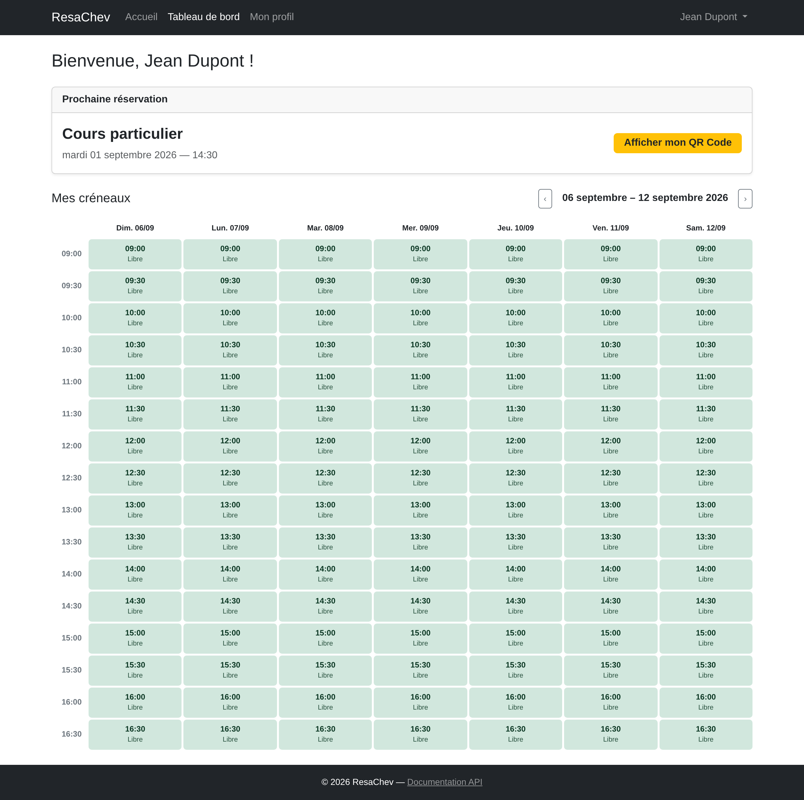
<p class="legende"><strong>Figure 8</strong> : Navigation vers la semaine suivante, sans rechargement de page.</p>

Les flèches ‹ et › font avancer ou reculer la grille de 7 jours. L'opération se fait **sans rechargement** : l'application Vue.js appelle l'API interne `GET /espace/creneaux?debut=AAAA-MM-JJ` avec `fetch()`, reçoit la nouvelle semaine au format JSON et met la grille à jour de façon réactive. Pendant le chargement, un indicateur « Chargement… » est affiché. On retrouve ici le principe d'une API consommée par du JavaScript vu en cours, mais protégée par la session web : seul un client connecté peut interroger cette route.

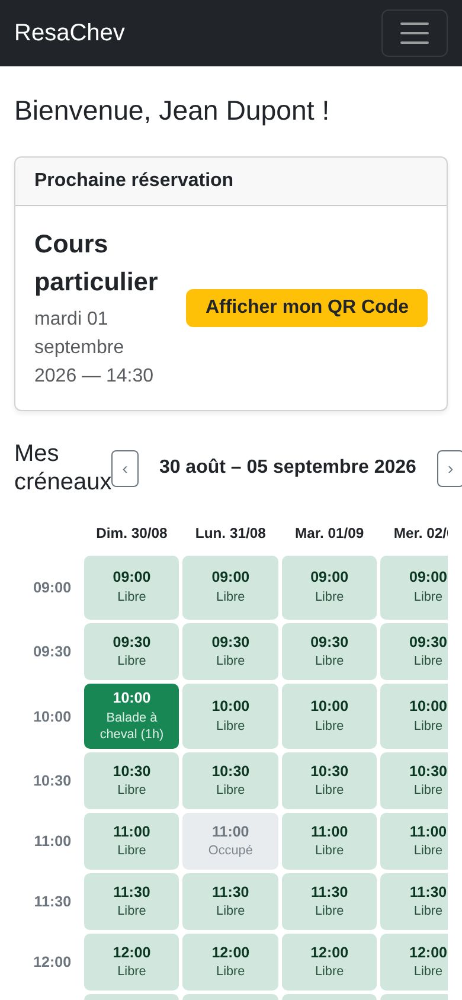
<p class="legende"><strong>Figure 9</strong> : Rendu du tableau de bord sur smartphone.</p>

L'interface est responsive grâce à la grille Bootstrap 5 : sur un écran étroit, le menu se replie derrière un bouton « hamburger », la carte de réservation empile ses éléments et la grille des créneaux devient défilante horizontalement afin de rester lisible. Les clients consultent en effet le plus souvent leur rendez-vous depuis leur téléphone, juste avant de présenter leur QR code.

| Règle | Description |
|---|---|
| RG-DASH-1 | Les créneaux sont calculés, non stockés : de `heureOuverture` à `heureFermeture` par pas de `dureeCreneau` (valeurs par défaut 08:00, 18:00 et 30 minutes). |
| RG-DASH-2 | La grille couvre 7 jours consécutifs ; la plage par défaut commence la veille du jour courant. |
| RG-DASH-3 | Un créneau occupé par un autre client n'expose ni son nom ni sa prestation. |
| RG-DASH-4 | Un clic sur une réservation du client ouvre son QR code ; le clic sur un créneau libre est réservé à une évolution (prise de réservation). |

### 2.5 Profil

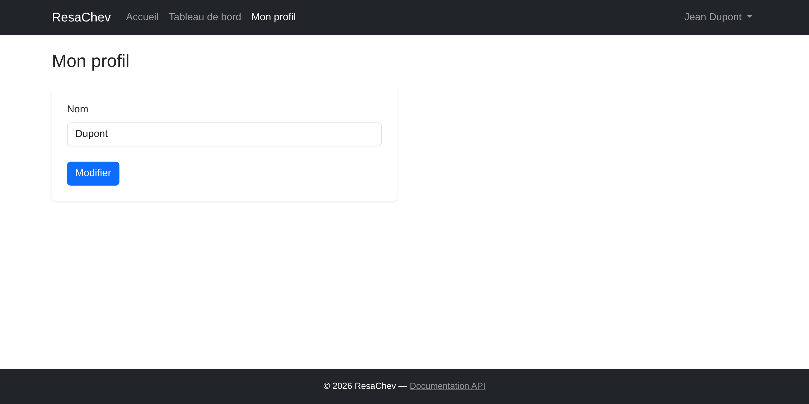
<p class="legende"><strong>Figure 10</strong> : Modification du profil.</p>

La page de profil affiche l'adresse email en lecture seule (elle sert d'identifiant de connexion) et permet de modifier le nom. Le formulaire est validé côté serveur (`nom` obligatoire, 100 caractères maximum) et un message de confirmation, transmis par la session flash (`with('statut', …)`), s'affiche après enregistrement. Le formulaire est conçu pour être étendu à d'autres champs (prénom, téléphone, changement de mot de passe).

### 2.6 Billet et QR code

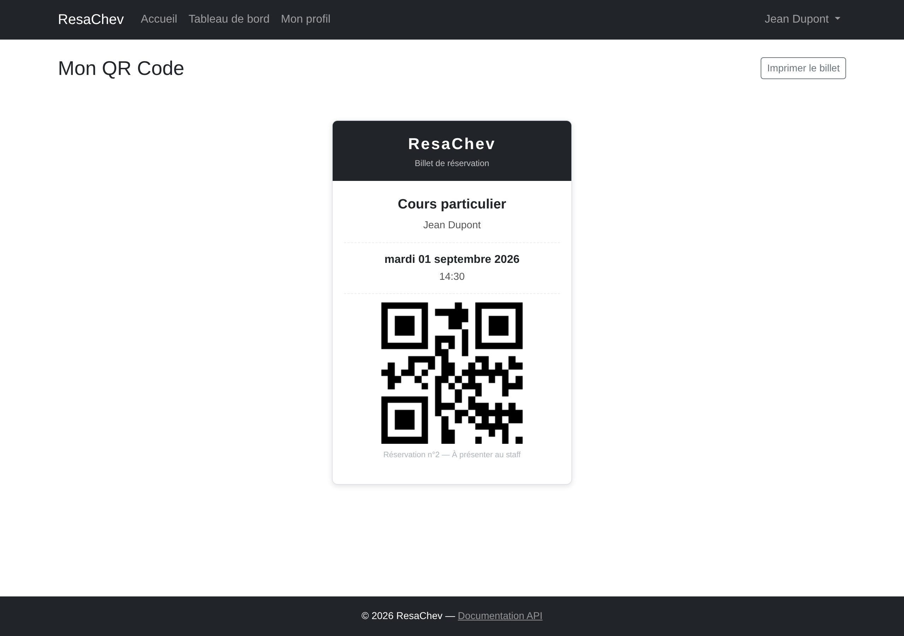
<p class="legende"><strong>Figure 11</strong> : Billet de réservation avec QR code.</p>

Le billet reprend la prestation, le nom du client, la date et l'heure du rendez-vous, et affiche un QR code qui encode uniquement l'identifiant de la réservation (`idreservation`). Le QR code est généré **dans le navigateur** par la librairie qrcodejs, servie localement : aucune donnée ne transite vers un service tiers. Le jour du rendez-vous, le staff scanne ce code avec l'application mobile, qui appelle l'API (`POST /api/mobile/valider-presence`) pour marquer la présence validée ; le tableau de bord reflète ensuite ce nouvel état. Le bouton « Imprimer le billet » déclenche `window.print()` ; une feuille de style d'impression (`print.css`) masque la navigation et centre le billet sur la page.

### 2.7 API mobile (staff)

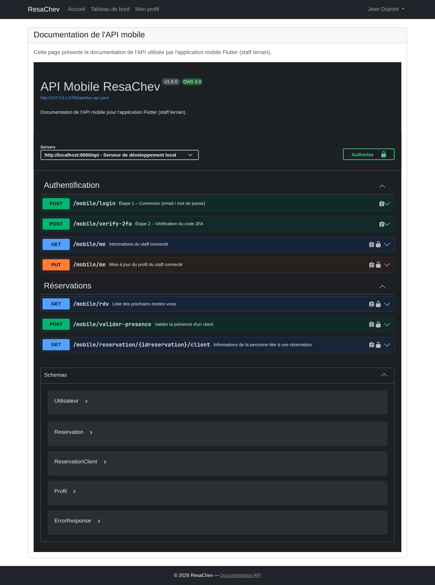
<p class="legende"><strong>Figure 12</strong> : Page de documentation de l'API mobile.</p>

Cette page, accessible librement depuis le pied de page, documente les routes de l'API intégrée au projet et destinée à l'application mobile du staff : pour chaque route, la méthode HTTP, les paramètres attendus et un exemple de réponse JSON. Elle sert de contrat d'interface entre l'équipe web et l'équipe mobile. L'API reprend le principe de la double authentification : après vérification du code 2FA, un **token Sanctum** est délivré, puis transmis dans l'en-tête `Authorization: Bearer` de chaque requête suivante. Seuls les comptes de rôle staff y ont accès.

| Méthode | Route | Authentification | Rôle |
|---|---|---|---|
| POST | `/api/mobile/login` | aucune | Vérifie email / mot de passe (rôle staff) et envoie le code 2FA |
| POST | `/api/mobile/verify-2fa` | aucune | Vérifie le code, révoque les anciens tokens, délivre un nouveau token |
| GET | `/api/mobile/me` | Bearer token | Profil du membre du staff connecté |
| PUT | `/api/mobile/me` | Bearer token | Met à jour le profil du staff connecté (nom uniquement pour l'instant) |
| GET | `/api/mobile/rdv` | Bearer token | Rendez-vous à traiter |
| POST | `/api/mobile/valider-presence` | Bearer token | Passe `validationpresence` à 1 pour la réservation scannée |
| GET | `/api/mobile/reservation/{idreservation}/client` | Bearer token | Informations de la personne rattachée à une réservation (identifiant lu dans le QR code) |

### 2.8 Récapitulatif des fonctionnalités

| Réf. | Fonctionnalité | Acteur | Statut |
|---|---|---|---|
| F1 | Page d'accueil | Visiteur | Livré |
| F2 | Connexion email + mot de passe + code 2FA par email | Visiteur → Client | Livré |
| F3 | Déconnexion (invalidation de session) | Client | Livré |
| F4 | Mot de passe oublié / réinitialisation | Visiteur | Livré |
| F5 | Tableau de bord : prochaine réservation | Client | Livré |
| F6 | Grille hebdomadaire des créneaux (Vue.js + API JSON) | Client | Livré |
| F7 | Modification du profil | Client | Livré - extensible |
| F8 | Billet QR code et impression | Client | Livré |
| F9 | API mobile (login 2FA, profil, rendez-vous, validation de présence, fiche client d'une réservation) | Staff | Livré |
| F10 | Prise de réservation depuis la grille | Client | Évolution |
| F11 | Hachage des mots de passe (bcrypt) | aucune | Évolution prioritaire |

## 3. Spécifications techniques

### 3.1 Stack technique

| Couche | Technologie | Justification |
|---|---|---|
| Langage serveur | PHP 8 (8.4 sur la ferme de serveurs) | Langage étudié, hébergement mutualisé très répandu |
| Framework | Laravel (routeur, contrôleurs, Eloquent, Blade, sessions, validation, Artisan) | Framework MVC vu en cours ; structure imposée, sécurité intégrée (CSRF, échappement XSS, requêtes préparées) |
| Base de données | MySQL / MariaDB 10.9, serveur mutualisé partagé avec les autres composants du système d'information | Contrainte du projet : données centralisées sur un même serveur |
| Authentification web | Sessions Laravel (guard `web`), implémentée manuellement | Comprendre le mécanisme plutôt que d'utiliser un kit (Breeze, Fortify) |
| Authentification API | Laravel Sanctum (tokens) | Solution standard de Laravel pour les applications mobiles |
| Emails | SMTP via `App\Utils\EmailHelpers` | Point d'entrée unique, remplaçable en test par le driver `log` |
| CSS | Bootstrap 5.3 + `main.css` + `print.css` | Rendu responsive rapide, mise en page d'impression maîtrisée |
| JavaScript | Vue.js 3 (Options API) et qrcodejs, servis localement | Interactivité de la grille, QR code sans dépendance réseau |
| Tests | PHPUnit (tests Feature) sur SQLite en mémoire | Non-régression des parcours critiques |

### 3.2 Architecture MVC

Laravel applique le patron **Modèle - Vue - Contrôleur** : le routeur associe chaque URL à une méthode de contrôleur ; le contrôleur porte la logique métier, interroge la base au travers des modèles Eloquent (ORM) et rend une vue Blade, ou une réponse JSON dans le cas de l'API.

```
Navigateur ──HTTP──▶ routes/web.php ──▶ Contrôleur ──▶ Modèle Eloquent ──▶ MySQL
                                            │
                                            ▼
                                       Vue Blade ──▶ HTML ──▶ Navigateur

App mobile ──HTTP──▶ routes/api.php ──▶ MobileController ──▶ Modèle ──▶ MySQL
                                            │
                                            ▼
                                          JSON ──▶ App mobile
```

**Le routeur** (`routes/web.php`, `routes/api.php`). Chaque route relie une méthode HTTP et une URL à une action de contrôleur, avec un nom utilisable dans les vues (`route('espace.dashboard')`). Les routes d'`api.php` sont automatiquement préfixées par `/api`. Exemple tiré du projet :

```php
Route::get('/connexion', [ConnexionController::class, 'index'])
    ->name('connexion');
Route::post('/connexion', [ConnexionController::class, 'login'])
    ->name('connexion.login');

// Groupe protégé : le middleware auth s'applique à toutes les routes
Route::middleware('auth')->group(function () {
    Route::get('/espace/tableau-de-bord', [EspaceController::class, 'dashboard'])
        ->name('espace.dashboard');
    Route::get('/espace/creneaux', [EspaceController::class, 'creneaux'])
        ->name('espace.creneaux');
});
```

**Les contrôleurs** (`app/Http/Controllers/`). `HomeController` (accueil, documentation API), `ConnexionController` (connexion, 2FA, déconnexion, mot de passe oublié), `EspaceController` (tableau de bord, créneaux JSON, profil, QR code) et `Api/MobileController` (API Sanctum). L'objet `Request` injecté par Laravel remplace `$_GET` / `$_POST` et porte la validation :

```php
$request->validate(['nom' => 'required|string|max:100']);
Auth::user()->update(['nom' => $request->nom]);
return redirect()->route('espace.profil')->with('statut', 'Profil mis à jour.');
```

**Les modèles** (`app/Models/`). Un modèle Eloquent par table métier. Le schéma ne suivant pas les conventions Laravel (noms français au singulier, clés `idxxx`, pas de timestamps), chaque modèle les déclare explicitement :

```php
class Reservation extends Model
{
    protected $table      = 'reservation';
    protected $primaryKey = 'idreservation';
    public    $timestamps = false;
    protected $fillable   = ['idutilisateur', 'idprestation', 'datedebut',
                             'heuredebut', 'validationpresence'];

    // Une réservation appartient à un utilisateur et concerne une prestation
    public function utilisateur()
    {
        return $this->belongsTo(Utilisateur::class, 'idutilisateur', 'idutilisateur');
    }

    public function prestation()
    {
        return $this->belongsTo(Prestation::class, 'idprestation', 'idprestation');
    }
}
```

**Les vues** (`resources/views/`). Templates Blade organisés par domaine (`connexion/`, `espace/`, `emails/`) et héritant d'un layout commun `layouts/app.blade.php` (`@extends`, `@section`, `@yield`). Les variables sont toujours passées explicitement : `return view('espace.profil', ['utilisateur' => $utilisateur])`.

**Le middleware `auth`.** Un middleware est un code intercepteur exécuté avant le contrôleur. Ici, il protège tout le groupe `/espace/*` : un visiteur non connecté est redirigé vers `/connexion` (configuration `redirectGuestsTo()` dans `bootstrap/app.php`). L'API utilise de même le middleware `auth:sanctum`, qui valide le token transmis.

**Parcours guidé : suivre une requête de bout en bout.** Prenons la modification du profil, la fonctionnalité la plus simple du projet.

| Étape | Fichier | Ce qui se passe |
|---|---|---|
| 1 | Navigateur | L'utilisateur ouvre `/espace/profil`. |
| 2 | `routes/web.php` (lignes 31-32) | `GET /espace/profil` → `EspaceController@profil` ; `POST /espace/profil` → `EspaceController@updateProfil`. Les deux sont dans le groupe `middleware('auth')`. |
| 3 | Middleware `auth` | Si personne n'est connecté, redirection vers `/connexion` ; sinon la requête continue. |
| 4 | `app/Http/Controllers/EspaceController.php`, méthode `profil()` | Récupère l'utilisateur connecté avec `Auth::user()` et le passe à la vue : `return view('espace.profil', ['utilisateur' => $utilisateur])`. |
| 5 | `resources/views/espace/profil.blade.php` | Affiche le formulaire avec `{{ $utilisateur->nom }}` ; il contient `@csrf` et poste sur `route('espace.profil.update')`. |
| 6 | `EspaceController@updateProfil()` | `$request->validate([...])` contrôle le champ `nom` ; `Auth::user()->update([...])` enregistre via le modèle `Utilisateur` (Eloquent génère l'`UPDATE`). |
| 7 | Retour | `redirect()->route('espace.profil')->with('statut', 'Profil mis à jour.')` : redirection vers l'étape 1 avec un message flash en session, affiché par la vue. |

Le même schéma (route → middleware → contrôleur → modèle → vue ou redirection) se retrouve dans toutes les fonctionnalités ; pour la 2FA, remplacer `EspaceController` par `ConnexionController` et suivre `login()` puis `verify2FA()`.

**Pourquoi ces choix techniques ?** Plusieurs partis pris du projet ont une raison pédagogique : l'**authentification est écrite à la main** (pas de Breeze ni Fortify) pour que chaque étape (recherche de l'utilisateur, vérification, `Auth::login()`, session) soit lisible dans le contrôleur ; les dates sont manipulées avec **`\DateTime` plutôt que Carbon** pour rester sur du PHP standard ; **Vue.js et qrcodejs sont servis localement** (pas de CDN, pas de Vite) pour que l'application fonctionne hors ligne sur la ferme de serveurs ; enfin la **grille utilise l'Options API** de Vue, plus explicite que la Composition API pour un premier contact.

### 3.3 Organisation des dossiers

```
front/
├── app/Http/Controllers/   HomeController, ConnexionController,
│                           EspaceController, Api/MobileController
├── app/Models/             Utilisateur, Reservation, Prestation, Role,
│                           Parametrage
├── app/Utils/              EmailHelpers (envoi d'emails centralisé)
├── bootstrap/app.php       Middlewares, redirection des invités
├── config/auth.php         Guard web → modèle Utilisateur, option 2fa_enabled
├── database/migrations/    Tables métier (schéma uniquement)
├── database/seeders/       ReferenceSeeder (données requises) + démo
├── database/factories/     UtilisateurFactory
├── doc/                    Documentation, captures, outils de génération
├── public/css, public/js   main.css, print.css, vue.global.prod.js, qrcode.min.js
├── resources/views/        layouts/, home, api-doc, connexion/, espace/, emails/
├── routes/                 web.php (session) et api.php (Sanctum)
├── tests/Feature/          Tests fonctionnels PHPUnit
└── .env                    Configuration locale (jamais versionnée)
```

### 3.4 Base de données

La base est **partagée** entre les trois applications : son schéma ne peut être modifié sans concertation entre les équipes. Les noms de tables et de colonnes sont en français, au singulier et en minuscules ; les clés primaires et étrangères sont préfixées par `id`. La structure est fournie sous deux formes complémentaires : le **modèle conceptuel** (`AP3_MCD_Initial.mcd`) et le **script SQL** de déploiement (`AP3_BD_reservation.sql`), tous deux disponibles sur Moodle. Les **migrations** Laravel (`database/migrations/`) reproduisent ce schéma. Les données de référence (rôles, paramètres par défaut, prestations d'exemple) ne sont pas créées par les migrations mais par des **seeders** (`database/seeders/`), regroupés dans `ReferenceSeeder`. Cette séparation isole le schéma des données, mais impose de lancer un seed sur tout environnement neuf : sans `parametrage`, l'application ne démarre pas. La commande de référence est `php artisan migrate:fresh --seed`. La lecture croisée du MCD et du script permet de vérifier l'unicité des données, la traduction des associations en clés étrangères, les contraintes associées, ainsi que la façon dont sont gérés les mots de passe et les dates.

| Table | Rôle | Usage dans cette application |
|---|---|---|
| `role` | Type d'utilisateur | `client` (1) ou `staff` (2) ; détermine l'accès à l'espace web ou à l'API |
| `utilisateur` | Comptes utilisateurs | Authentification, profil ; seule table avec `created_at` / `updated_at`, colonnes techniques pour la 2FA et la réinitialisation |
| `prestation` | Catalogue des prestations | Libellé et tarif, affichés sur le tableau de bord et le billet |
| `reservation` | Rendez-vous d'un client | Tableau de bord, grille des créneaux, QR code ; `validationpresence` passe à 1 après scan |
| `parametrage` | Configuration de la plateforme | `nomPlateforme`, `dureeCreneau`, `heureOuverture`, `heureFermeture`, lus via `Parametrage::getValeur()` |

Le modèle `Utilisateur` a deux particularités : il étend `Authenticatable` (et non `Model`) pour s'intégrer au système d'authentification de Laravel, et redéfinit `getAuthPassword()` afin d'utiliser la colonne `motpasse` à la place du `password` attendu par défaut. Il porte aussi les méthodes métier `verifierCode2FA()` et `prochaineReservation()`.

### 3.5 Flux de connexion 2FA

```
Navigateur            ConnexionController          BDD              Email
    │  POST /connexion         │                     │                 │
    │ ────────────────────────▶│  SELECT utilisateur │                 │
    │                          │ ───────────────────▶│                 │
    │                          │  vérif. mot de passe│                 │
    │                          │  UPDATE code + expiration            │
    │                          │ ───────────────────▶│  envoi du code  │
    │                          │ ─────────────────────────────────────▶│
    │  302 /connexion/verification (email en session)                  │
    │ ◀────────────────────────│                     │                 │
    │  POST code               │                     │                 │
    │ ────────────────────────▶│  verifierCode2FA()  │                 │
    │                          │ ───────────────────▶│                 │
    │                          │  code effacé, Auth::login(), session régénérée
    │  302 /espace/tableau-de-bord                   │                 │
    │ ◀────────────────────────│                     │                 │
```

La vérification du code est portée par le modèle, ce qui la rend testable indépendamment du contrôleur :

```php
public function verifierCode2FA(string $code): bool
{
    return $this->two_factor_code === $code
        && $this->two_factor_expires_at !== null
        && now()->lessThanOrEqualTo($this->two_factor_expires_at);
}
```

### 3.6 Grille des créneaux : API interne et Vue.js

La grille illustre une architecture **client / serveur découplée** à l'intérieur même d'une page :

```
Navigateur (Vue.js)                        Serveur Laravel
    │  chargement de la page                     │
    │  mounted() → charger(hier())               │
    │  fetch GET /espace/creneaux?debut=...      │
    │ ──────────────────────────────────────────▶│  middleware auth
    │                                            │  EspaceController@creneaux
    │                                            │  paramètres + réservations (BDD)
    │  JSON { semaine, jours[ slots[] ] }        │
    │ ◀──────────────────────────────────────────│
    │  jours = ... → la grille se redessine       │
    │  clic ‹ / › → precedente() / suivante()    │
    │  → nouveau fetch (même cycle)              │
```

Le code JavaScript se trouve dans `resources/views/espace/dashboard.blade.php`, bloc `@push('scripts')` : la méthode `charger()` (vers la ligne 220) contient l'appel `fetch()`, et `precedente()` / `suivante()` ne font que recalculer la date avant de la rappeler.

1. **Côté serveur**, `EspaceController@creneaux` répond à `GET /espace/creneaux?debut=AAAA-MM-JJ` par un document JSON : la plage affichée, puis pour chacun des 7 jours la liste des créneaux avec leur statut et, le cas échéant, la prestation du client. Le contrôleur calcule la plage, lit les paramètres (`Parametrage::getValeur()`), génère les heures avec `\DateTime`, charge les réservations du client puis les créneaux occupés (colonnes minimales, sans donnée personnelle), et attribue un statut par priorité : `valide` / `ma_reservation`, sinon `occupe`, sinon `libre`.
2. **Côté navigateur**, une application Vue.js 3 (`#app-creneaux`, Options API) charge les données avec `fetch()` au démarrage puis à chaque navigation, et met la grille à jour grâce aux directives `v-for` (jours et créneaux), `:class` (couleur selon le statut) et `@click` (ouverture du QR code).

```json
{
  "debut": "2026-08-24",
  "semaine": "24 août - 30 août 2026",
  "jours": [
    {
      "date": "2026-08-24",
      "label": "Lun. 24/08",
      "slots": [
        { "heure": "09:00", "statut": "libre",  "prestation": null },
        { "heure": "10:00", "statut": "valide", "prestation": "Balade à cheval (1h)" }
      ]
    }
  ]
}
```

### 3.7 Sécurité

| Mesure | Mise en œuvre dans le projet |
|---|---|
| Double authentification | Code à 6 chiffres envoyé par email, expiration 10 min, usage unique, session ouverte seulement après validation |
| Protection CSRF | Jeton `@csrf` sur tous les formulaires ; régénération du jeton à la déconnexion |
| Fixation de session | `session()->regenerate()` après connexion, `invalidate()` à la déconnexion |
| Contrôle d'accès | Middleware `auth` sur `/espace/*` ; `auth:sanctum` et contrôle du rôle staff sur l'API |
| Injection SQL | Requêtes Eloquent / Query Builder, donc préparées |
| XSS | Échappement automatique de Blade (`{{ }}`) |
| Énumération de comptes | Messages génériques à la connexion et pour le mot de passe oublié |
| Confidentialité | La grille n'expose aucune donnée sur les réservations des autres clients |
| Secrets | `.env` hors du dépôt Git ; clé d'application `APP_KEY` propre à chaque installation |
| **Mots de passe** | **Point de vigilance** : le code actuel compare le mot de passe en clair. Conformément au cours et à l'OWASP, la migration vers `password_hash()` / `password_verify()` (bcrypt, sel automatique) est l'évolution prioritaire (F11). |

### 3.8 Tests

Des tests fonctionnels PHPUnit (`tests/Feature/`) couvrent les parcours critiques : connexion (identifiants valides ou non, code 2FA valide, incorrect ou expiré, accès direct à la page de vérification), mot de passe oublié, espace connecté (redirection des visiteurs, tableau de bord, API créneaux, profil, QR code), page d'accueil et API mobile. Ils s'exécutent sur une base SQLite en mémoire, sans toucher à la base MySQL. Le fichier `tests/TestCase.php` déclare `$seeder = ReferenceSeeder::class` : les données de référence n'étant plus dans les migrations, chaque test doit les recharger, faute de quoi la clé étrangère `utilisateur.idrole` et la lecture de `parametrage` échouent.

```bash
php artisan test
```

La suite compte 90 tests, tous au vert.

## 4. Premier démarrage

### 4.1 Environnement mis à disposition

L'application est destinée à être implantée dans un **environnement client-serveur** (ferme de serveurs : serveur de base de données, serveur web) et à mettre en place les outils de travail collaboratif. Le site web doit être accessible à n'importe quel utilisateur, donc installé sur un serveur web distant ; le système d'exploitation est libre mais le choix doit être justifié.

Deux services partagés structurent cet environnement : un **serveur de base de données mutualisé** (MariaDB), sur lequel chaque équipe demande la création de ses comptes et de leurs droits, et une **plateforme e-mail de type mail catcher** qui intercepte tous les messages envoyés par l'application. Ce second point est essentiel pour ResaChev : la double authentification et la réinitialisation de mot de passe reposent sur l'e-mail, et le mail catcher permet de les tester sans qu'aucun message n'atteigne un destinataire réel. Les adresses de ces services, du site existant et des dépôts Git figurent dans le descriptif du projet.

### 4.2 Prérequis sur le poste de développement

- PHP 8.3 minimum avec les extensions `pdo_mysql`, `mbstring`, `openssl` ;
- Composer (gestionnaire de dépendances PHP) ;
- un accès au serveur MariaDB mutualisé (compte créé via bddap3) ou une base locale ;
- pour les e-mails : le mail catcher ci-dessus, ou `MAIL_MAILER=log` en local.

### 4.3 Installation

Le projet est récupéré depuis Git ; on n'utilise donc pas `composer create-project` mais on réinstalle les dépendances (`vendor/` n'est pas versionné) et on recrée le fichier `.env`, lui aussi exclu du dépôt car il contient les identifiants et les clés secrètes.

```bash
git clone <url-du-depot> front
cd front
composer install              # installe Laravel et les dépendances dans vendor/
cp .env.example .env          # configuration locale à compléter
php artisan key:generate      # génère APP_KEY (chiffrement des sessions et cookies)
```

### 4.4 Configuration (`.env`)

| Variable | Valeur | Rôle |
|---|---|---|
| `APP_URL` | `http://localhost:8000` | URL utilisée dans les liens envoyés par email |
| `DB_CONNECTION` | `mysql` | Pilote de base de données (compatible MariaDB) |
| `DB_HOST`, `DB_DATABASE`, `DB_USERNAME`, `DB_PASSWORD` | selon l'environnement | Connexion à la base partagée |
| `MAIL_MAILER`, `MAIL_HOST`, `MAIL_PORT` | `smtp`, `mail.dombtsig.local`, port SMTP du mail catcher | Envoi des e-mails (2FA, réinitialisation) vers la plateforme de test |
| `AUTH_2FA_ENABLED` | `true` | Active la double authentification ; `false` en développement pour se passer de SMTP |

> Astuce vue en TP : `MAIL_MAILER=log` écrit les emails dans `storage/logs/laravel.log` au lieu de les envoyer. On peut ainsi tester la 2FA et le mot de passe oublié sans serveur mail.

### 4.5 Base de données et lancement

```bash
# Soit : exécuter AP3_BD_reservation.sql sur la base (phpMyAdmin), soit :
php artisan migrate:fresh --seed   # crée le schéma puis charge toutes les données
php artisan serve             # serveur de développement sur http://localhost:8000
php artisan serve --host=0.0.0.0   # accessible depuis un autre appareil du réseau
```

`migrate:fresh --seed` est la commande à retenir : elle supprime les tables, recrée le schéma, charge les données de référence, puis ajoute deux comptes clients (`test@example.com` et `marie@example.com`, mot de passe `password`) avec six réservations réparties autour de la date du jour. Les migrations seules ne créent que les tables : sans le seed, `role`, `parametrage` et `prestation` restent vides et l'application ne démarre pas.

Comme `migrate:fresh` détruit les tables existantes, elle est à réserver à une base de développement. Sur une base à conserver, charger uniquement les données de référence avec `php artisan db:seed --class=ReferenceSeeder`.

Pour travailler sans serveur MySQL ni serveur SMTP, le dépôt fournit un fichier `.env.sqlite` :

```bash
touch database/database.sqlite
php artisan --env=sqlite migrate:fresh --seed
php artisan --env=sqlite serve
```

### 4.6 Commandes Artisan utiles

| Commande | Usage |
|---|---|
| `php artisan list` | Liste toutes les commandes disponibles |
| `php artisan route:list` | Affiche toutes les routes web et API avec leur contrôleur |
| `php artisan tinker` | Console interactive : tester Eloquent (`Utilisateur::all()`), exécuter du PHP dans le contexte de l'application |
| `php artisan make:controller NomController` | Crée un contrôleur |
| `php artisan make:model Nom -m` | Crée un modèle et sa migration |
| `php artisan make:middleware Nom` | Crée un middleware |
| `php artisan migrate:rollback` | Annule la dernière migration |
| `php artisan migrate:fresh --seed` | Installe ou réinitialise la base : schéma, données de référence et de démonstration |
| `php artisan db:seed --class=ReferenceSeeder` | Charge les seules données de référence, sans détruire les tables existantes |
| `php artisan test` | Exécute les tests PHPUnit |
| `php artisan config:clear` / `cache:clear` | Vide les caches après modification de la configuration |

## Annexe - Génération de ce document

Le document et ses captures d'écran sont générés automatiquement afin de rester synchronisés avec l'application :

```bash
bash doc/tools/build.sh        # base SQLite temporaire + seed de démo + captures + PDF
bash doc/tools/build.sh pdf    # régénère uniquement le PDF depuis doc/sfd-std.md
```

- `doc/tools/seed-demo.php` : jeu de données de démonstration (utilisateurs, prestations, réservations) ;
- `doc/tools/screenshots.mjs` : pilote Chrome headless (protocole DevTools, sans dépendance npm), parcourt l'application, se connecte avec la 2FA (le code est lu dans le log mail) et capture chaque écran dans `doc/images/` ;
- `doc/tools/md2pdf.php` : convertit le Markdown en HTML (league/commonmark, fourni par Laravel) puis en PDF avec Chrome, en deux passes pour numéroter la table des matières.

La base MySQL n'est jamais sollicitée : les variables d'environnement surchargent `.env` le temps de la génération.
