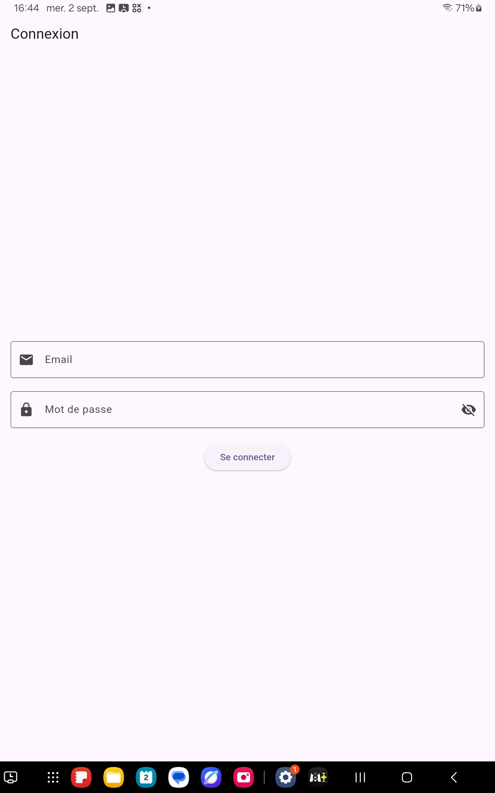
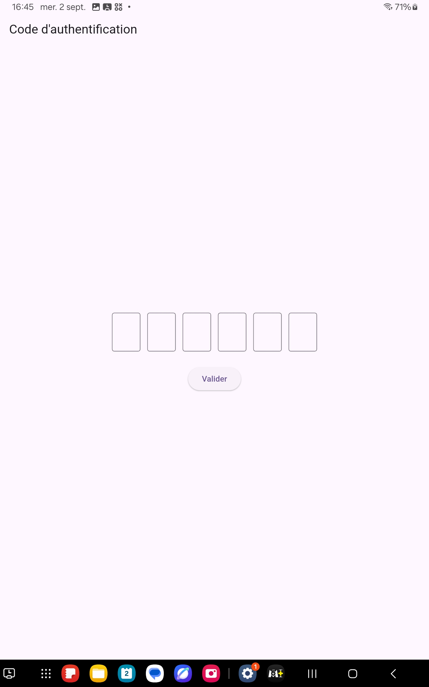

# Authentification – ResaChev Application mobile (Flutter)

L'accès à l'application est réservé au personnel de **rôle staff** (`idrole = 2`) et se fait en **deux étapes** : identifiants, puis code à usage unique reçu par email (double authentification, *2FA*).

| Écran | Classe | Fichier |
|---|---|---|
| Connexion | `LoginUtilisateur` | `lib/screens/screen_login/log_user.dart` |
| Code de vérification | `TwoFaUser` | `lib/screens/screen_login/twofa_user.dart` |
| Service d'appel à l'API | `UsrApi` | `lib/services/api/gestionUsr/usr_api.dart` |
| Stockage du jeton | `GestionToken` | `lib/services/gestion_token/token.dart` (stockage sécurisé `flutter_secure_storage`) |

---

## Le parcours complet

```
LoginUtilisateur                       API Laravel                     TwoFaUser
      │                                     │                              │
      ├─ email + mot de passe ─────────────▶│ POST /api/mobile/login       │
      │                                     ├─ rôle staff ? mot de passe ? │
      │                                     ├─ génère un code à 6 chiffres │
      │                                     ├─ envoie l'email (MailHog)    │
      │◀──── { message, email } ────────────┤                              │
      ├─ pushReplacement ─────────────────────────────────────────────────▶│
      │                                     │                              │
      │                                     │ POST /api/mobile/verify-2fa ◀┤ code à 6 chiffres
      │                                     ├─ vérifie le code, l'invalide │
      │                                     ├─ révoque les anciens jetons  │
      │                                     ├─ crée un jeton Sanctum       │
      │                                     ├──── { token, utilisateur } ─▶│
      │                                     │                              ├─ GestionToken.saveToken() (stockage sécurisé)
      │                                     │                              └─ pushReplacement ─▶ PageLogP
```

Le jeton n'est **jamais** émis à la première étape : tant que le code n'est pas validé, connaître le mot de passe ne donne aucun accès à l'API.

---

## Écran de connexion — `LoginUtilisateur`



L'écran présente deux champs et un bouton. Le mot de passe est masqué par défaut (`obscureText`), avec une icône œil pour l'afficher :

```dart
TextField(
  controller: passwordController,
  obscureText: !isPasswordVisible,
  decoration: InputDecoration(
    labelText: 'Mot de passe',
    prefixIcon: Icon(Icons.lock),
    border: OutlineInputBorder(),
    suffixIcon: IconButton(
      icon: Icon(isPasswordVisible ? Icons.visibility : Icons.visibility_off),
      onPressed: () => setState(() => isPasswordVisible = !isPasswordVisible),
    ),
  ),
)
```

Le `TextEditingController` est l'équivalent Flutter de la propriété `Text` d'une `TextBox` Windows Forms : c'est lui qui détient la valeur saisie, lue par `emailController.text`. `setState()` est ce qui déclenche la reconstruction de l'écran après le clic sur l'icône — sans lui, la valeur changerait sans que rien ne soit redessiné.

Le champ email déclare `keyboardType: TextInputType.emailAddress`, ce qui fait apparaître un clavier comportant `@` et `.` : un détail d'ergonomie propre au mobile.

### Enchaînement à la validation

```
_login()
   │
   ├─ email ou mot de passe vide ?  ──▶ SnackBar « Veuillez remplir tous les champs »
   │
   └─ UsrApi().loginUser(email, password)
         │
         ├─ succès ──▶ pushReplacement vers TwoFaUser(email: email)
         │
         └─ échec  ──▶ SnackBar reprenant le message renvoyé par l'API
```

Le succès est reconnu de deux façons :

```dart
final isSuccess = result != null &&
    (result['ok'] == true ||
     message.toLowerCase().contains('un code de vérification a été envoyé par email'));
```

> **Points de vigilance.**
> 1. La seconde condition compare le **texte** du message renvoyé par le serveur. Une reformulation côté Laravel — une majuscule, un mot en plus — casserait silencieusement la connexion. Le service devrait s'appuyer sur le seul code HTTP et sur `ok`.
> 2. Aucun **indicateur de chargement** : la requête dure jusqu'à 45 secondes et rien ne bouge à l'écran. L'utilisateur appuie plusieurs fois, ce qui déclenche autant de requêtes et autant d'emails. Désactiver le bouton pendant l'appel et afficher un `CircularProgressIndicator` est la correction attendue.
> 3. Le format de l'email n'est **pas contrôlé** avant l'envoi, contrairement à l'application de gestion (`Controleur.ValidMail()`). Ici, c'est la validation Laravel (`required|email`) qui rejette la saisie, au prix d'un aller-retour réseau.
> 4. `SnackBar` sans `const` et `Text` non `const` déclenchent des avertissements de lint (`prefer_const_constructors`).

---

## Écran du code de vérification — `TwoFaUser`



L'écran reçoit l'email par son constructeur — il en a besoin pour identifier le compte lors de la vérification :

```dart
class TwoFaUser extends StatefulWidget {
  final String email;
  const TwoFaUser({super.key, required this.email});
}
```

C'est l'équivalent du `FormModifEmail(uint idU)` de l'application C# : la donnée nécessaire est passée au constructeur, et non récupérée depuis un autre écran.

### Les six champs et le focus automatique

Le code est saisi dans **six champs d'un caractère**, disposition classique sur mobile. Deux listes parallèles sont créées, une de contrôleurs et une de `FocusNode` :

```dart
final List<FocusNode> _focusNodes = List.generate(6, (_) => FocusNode());
final List<TextEditingController> _controllers = List.generate(6, (_) => TextEditingController());

String get _code => _controllers.map((c) => c.text).join();      // recomposition du code
bool get _isCodeComplete => _controllers.every((c) => c.text.isNotEmpty);

void _onDigitEntered(int index, String value) {
  if (value.isNotEmpty && index < 5) {
    _focusNodes[index + 1].requestFocus();   // saisie d'un chiffre → champ suivant
  }
  setState(() {});
}
```

Chaque champ n'accepte qu'un chiffre, grâce à deux réglages combinés :

```dart
maxLength: 1,
keyboardType: TextInputType.number,
inputFormatters: [FilteringTextInputFormatter.digitsOnly],
decoration: InputDecoration(counterText: ""),   // masque le compteur « 0/1 »
```

`FilteringTextInputFormatter.digitsOnly` filtre la saisie **au moment de la frappe** : un caractère non numérique n'apparaît jamais, y compris s'il vient d'un collage.

### La libération des ressources

```dart
@override
void dispose() {
  for (var c in _controllers) { c.dispose(); }
  for (var f in _focusNodes)  { f.dispose(); }
  super.dispose();
}
```

`dispose()` est appelé automatiquement quand l'écran est détruit. Omettre la libération des douze objets provoquerait une **fuite mémoire** : c'est l'équivalent du `using` de C#, appliqué au cycle de vie d'un widget.

### Enchaînement à la validation

```
_submitCode()
   │
   ├─ un champ vide ? ──▶ SnackBar « Veuillez saisir les 6 chiffres du code. »
   │
   └─ UsrApi().verifyUser(email, code)
         │
         ├─ jeton + utilisateur reçus ──▶ GestionToken.saveToken(token)
         │                                pushReplacement vers PageLogP
         │
         └─ échec ──▶ SnackBar « Code invalide ou expiré. »
```

| Règle | Description |
|---|---|
| RG-AUTH-1 | Seul un utilisateur de rôle **staff** peut se connecter ; l'API refuse tout autre rôle avec un code 401. |
| RG-AUTH-2 | La connexion se déroule en deux étapes : identifiants, puis code à 6 chiffres reçu par email. |
| RG-AUTH-3 | Le jeton n'est émis qu'après validation du code ; il est alors stocké **chiffré** sur l'appareil. |
| RG-AUTH-4 | Les six chiffres sont obligatoires ; la saisie n'accepte que des chiffres. |
| RG-AUTH-5 | Le code est invalidé après usage et les jetons antérieurs sont révoqués : une seule session active par compte. |

> **Points de vigilance.**
> 1. Aucun bouton « **renvoyer le code** » : si l'email n'arrive pas ou si le code expire, l'utilisateur n'a d'autre choix que de fermer l'application et de recommencer — et l'écran n'offre même pas de retour arrière, `pushReplacement` ayant supprimé l'écran de connexion de la pile.
> 2. La **durée de validité** du code n'est indiquée nulle part à l'écran.
> 3. Le collage d'un code à 6 chiffres depuis l'email ne remplit que le premier champ : `maxLength: 1` tronque la valeur collée.
> 4. Comme à l'écran précédent, rien n'indique qu'une requête est en cours et le bouton reste actif.

---

## Le service `UsrApi`

`UsrApi` regroupe les deux appels du parcours de connexion. Les deux méthodes suivent la même structure : construction de l'URL, envoi, décodage prudent du corps, puis traduction du code HTTP en un résultat exploitable par l'écran.

```dart
Future<Map<String, dynamic>?> loginUser(String mail, String paswd) async {
  final url = Uri.parse('${AppConfig.apiBaseUrl}/mobile/login');
  try {
    final response = await http.post(
      url,
      headers: {'Content-Type': 'application/json; charset=UTF-8', 'Accept': 'application/json'},
      body: jsonEncode({'email': mail, 'motpasse': paswd}),
    ).timeout(const Duration(seconds: 45));
    // … décodage du corps, puis analyse de response.statusCode
  } catch (e) {
    return {'ok': false, 'message': 'Erreur inattendue pendant la connexion API.', 'user': null};
  }
}
```

Trois pratiques à retenir :

- **Le `timeout`** borne l'attente : sans lui, une requête vers un serveur injoignable peut rester en suspens très longtemps, l'écran figé sans explication.
- **Le décodage est protégé** par son propre `try/catch` et par un test de type (`decoded is Map<String, dynamic>`) : une réponse vide ou une page d'erreur HTML ne fait pas planter l'application.
- **Le résultat est uniforme** : toutes les branches retournent une `Map` avec les mêmes clés (`ok`, `message`, `user`), si bien que l'écran appelant n'a qu'un seul format à traiter.

L'enregistrement du jeton a lieu **dans le service**, dès que la réponse est valide :

```dart
if (hasToken && hasUser) {
  await GestionToken.saveToken(data?['token']);
  return {'ok': true, 'message': …, 'token': data?['token'], 'user': data?['utilisateur']};
}
```

> **Points de vigilance.**
> 1. Ce résultat en `Map<String, dynamic>` fait perdre le typage : `result['ok']`, `result['user']` ne sont vérifiés qu'à l'exécution, et une faute de frappe sur une clé passe la compilation. Une petite classe `ResultatConnexion` (ou un `sealed class` succès/échec) rendrait les erreurs visibles dès la compilation.
> 2. Le type de retour `Future<Map<String, dynamic>?>` est **nullable** alors qu'aucun chemin ne retourne `null` : chaque appelant doit malgré tout écrire `result?[…]`.
> 3. `loginUser()` et `verifyUser()` sont des **méthodes d'instance** (`UsrApi().loginUser(…)`) alors que `ReservationApi` — et, dans la même classe, la nouvelle méthode `UsrApi.rechercherInfoUsr()` (voir [api-et-donnees.md](api-et-donnees.md)) — expose des **méthodes statiques** : deux conventions cohabitent désormais jusque dans un même fichier. À uniformiser.
> 4. Le code de vérification et le mot de passe circulent en **HTTP non chiffré** (voir [architecture.md](architecture.md)) : sur un réseau partagé, une écoute passive suffit à les capter. Depuis la réinitialisation du projet, le manifeste Android n'autorise plus le trafic en clair : ces appels échouent purement et simplement en compilation *release*.
> 5. Côté serveur, le mot de passe est comparé **en clair** (`$request->motpasse !== $utilisateur->motpasse`, avec un `TODO` explicite dans le contrôleur Laravel). Ce défaut appartient au dépôt web, mais il concerne directement la sécurité de cette application.
