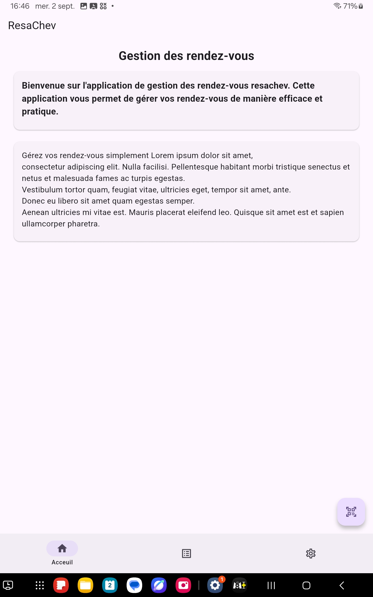
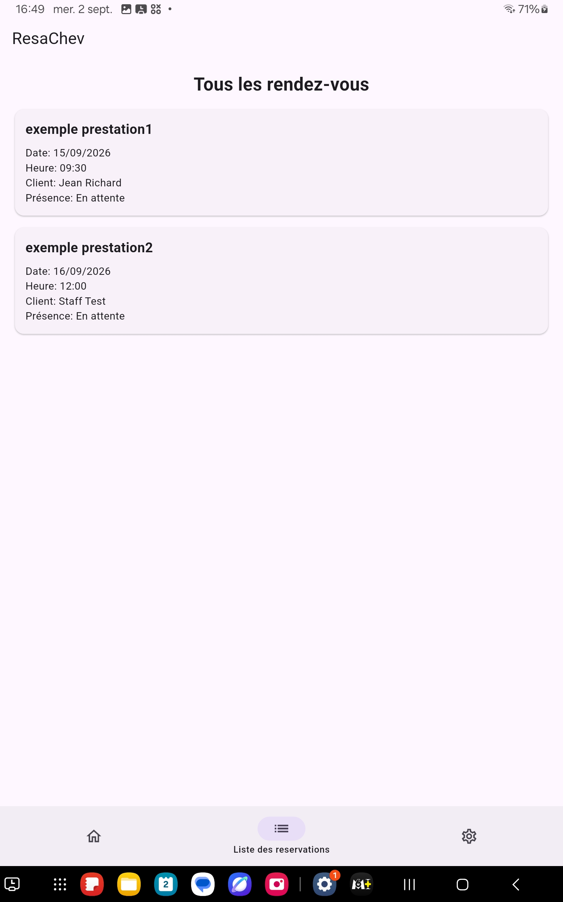
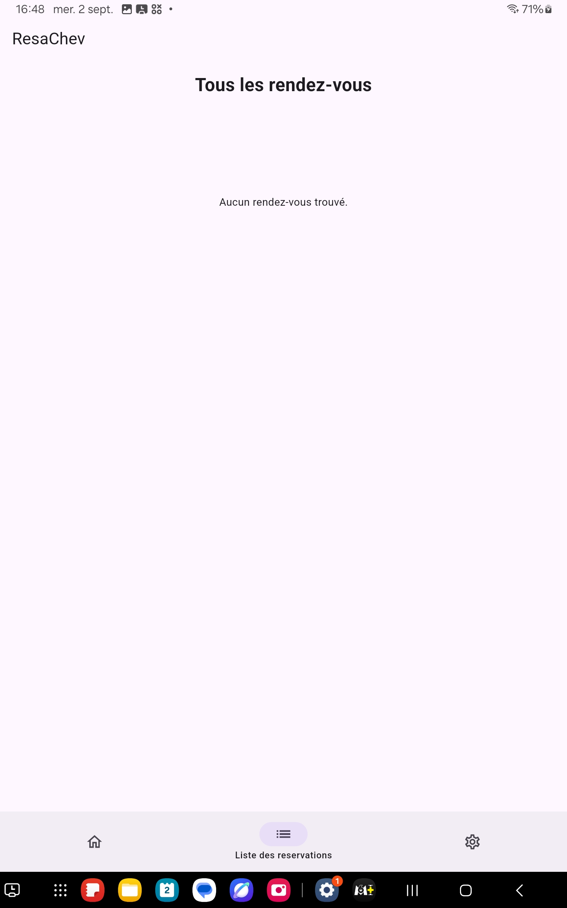
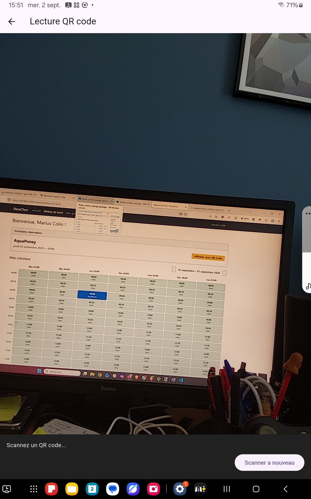
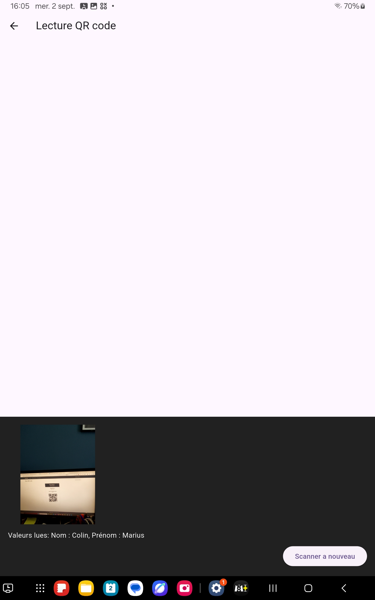
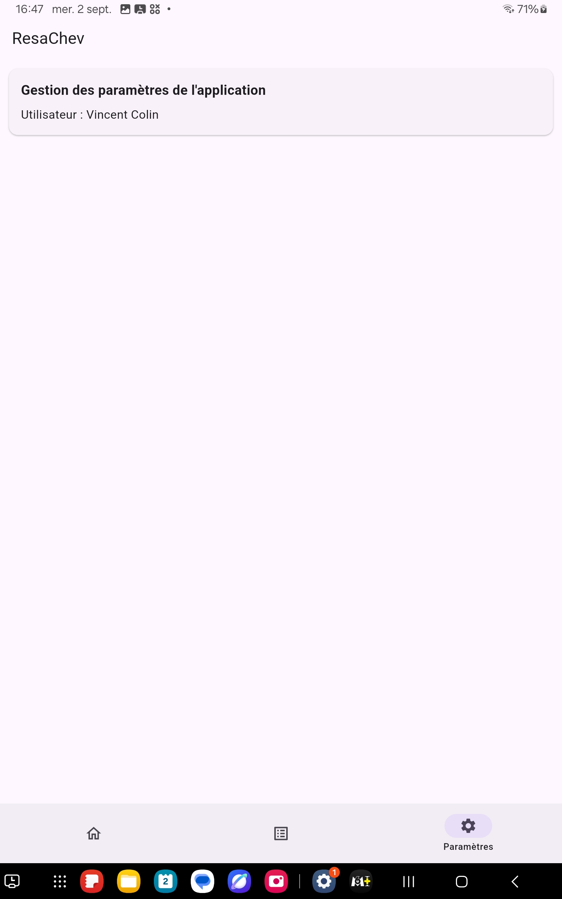

# Rendez-vous et scan – ResaChev Application mobile (Flutter)

Quatre écrans composent le cœur métier de l'application, accessibles une fois la connexion validée.

| Écran | Classe | Accès |
|---|---|---|
| Accueil | `Accueil` | Onglet 🏠 de la barre de navigation |
| Liste des rendez-vous | `Affichagerdv` | Onglet 📋 de la barre de navigation |
| Lecture du QR code | `QrScannerScreen` | Bouton flottant de l'accueil (nouvel écran empilé) |
| Paramètres | `ParamApp` | Onglet ⚙️ — identité du staff connecté |

---

## Accueil — `Accueil`



L'accueil présente l'application dans deux `Card` et porte le **bouton flottant** d'accès au scanner, l'action principale du staff sur le terrain :

```dart
floatingActionButton: FloatingActionButton(
  onPressed: () => Navigator.of(context).push(
    MaterialPageRoute<void>(builder: (_) => const QrScannerScreen()),
  ),
  tooltip: 'Lire un QR code',
  child: const Icon(Icons.qr_code_scanner),
)
```

Le `FloatingActionButton` est la convention Material pour l'action la plus fréquente d'un écran : toujours visible, atteignable au pouce.

> **Points de vigilance.**
> 1. Le second `Card` contient encore du texte de remplissage **Lorem ipsum** : à remplacer par un contenu utile (rappel du nombre de rendez-vous du jour, identité du staff connecté, version de l'application via `AppConfig.appVersion`).
> 2. `Accueil` est un `StatefulWidget` sans aucun état : un `StatelessWidget` suffirait.
> 3. Cet écran imbrique un `Scaffold` dans le `Scaffold` de `PageLogP`. Cela fonctionne, mais un second `Scaffold` ajoute une couche inutile ; seul le bouton flottant justifie ici cette imbrication — il pourrait être remonté dans la coquille.

---

## Liste des rendez-vous — `Affichagerdv`



L'écran appelle l'API au premier affichage et présente une carte par réservation.

### Le chargement asynchrone

La requête est lancée **une seule fois**, dans `initState()`, et le résultat est conservé dans un `Future` :

```dart
late Future<List<Reservation>> _futureReservations;

@override
void initState() {
  super.initState();
  _futureReservations = ReservationApi.listerReservations();
}
```

Lancer la requête dans `build()` serait une erreur classique : `build()` peut être appelée de nombreuses fois (rotation, clavier, `setState`), et l'API serait interrogée à chaque fois.

L'affichage est ensuite piloté par un `FutureBuilder`, qui redessine l'écran à chaque changement d'état de la requête :

```dart
FutureBuilder<List<Reservation>>(
  future: _futureReservations,
  builder: (context, snapshot) {
    if (snapshot.connectionState == ConnectionState.waiting) {
      return const Center(child: CircularProgressIndicator());   // 1. en cours
    }
    if (snapshot.hasError) {
      return /* message + bouton « Réessayer » */;               // 2. erreur
    }
    final reservations = snapshot.data ?? [];
    if (reservations.isEmpty) {
      return /* « Aucun rendez-vous trouvé. » */;                // 3. liste vide
    }
    return /* ListView.builder */;                               // 4. données
  },
)
```

Les **quatre états** d'un chargement distant sont ainsi traités explicitement : en cours, en erreur, vide, et rempli. C'est la structure attendue de tout écran alimenté par une API.

`ListView.builder` ne construit que les cartes visibles à l'écran : la liste peut compter des centaines de rendez-vous sans coût mémoire supplémentaire.

### Le rafraîchissement par balayage

```dart
Future<void> _rafraichir() async {
  setState(() { _futureReservations = ReservationApi.listerReservations(); });
  await _futureReservations;
}
```

Le `RefreshIndicator` enveloppe la liste : un balayage vers le bas relance la requête. Le geste est également disponible sur la liste vide — c'est pourquoi celle-ci est construite avec un `ListView` et non un simple `Center`, un widget non défilable ne pouvant déclencher le geste.

### Contenu d'une carte



| Ligne | Contenu | Source |
|---|---|---|
| Titre | `Balade à cheval` | `prestation`, ou « Prestation non précisée » |
| Date | `07/07/2026` | `datedebut`, reformatée en `jj/mm/aaaa` |
| Heure | `09:00` | `heuredebut`, reformatée en `HH:mm` |
| Client | `Jean Martin` | `client.prenom` + `client.nom`, ou « Non renseigné » |
| Présence | `Validée` / `En attente` | `validationpresence` |

Le nom complet est composé en écartant les valeurs absentes ou vides, ce qui évite les espaces parasites :

```dart
final nomComplet = [reservation.utilisateur?.prenom, reservation.utilisateur?.nom]
    .where((value) => value != null && value.trim().isNotEmpty)
    .join(' ');
```

Chaque valeur affichée dispose d'un **repli** (« Non définie », « Non renseigné ») : une réservation incomplète s'affiche dégradée plutôt que de faire planter l'écran.

| Règle | Description |
|---|---|
| RG-RDV-1 | La liste n'est accessible qu'à un utilisateur disposant d'un jeton ; sans jeton, l'onglet est refusé. |
| RG-RDV-2 | L'API retourne les réservations **à partir d'aujourd'hui**, triées par date puis par heure croissantes. |
| RG-RDV-3 | Un balayage vers le bas rafraîchit la liste. |
| RG-RDV-4 | Une donnée absente est remplacée par un libellé de repli, jamais par une erreur. |

> **Points de vigilance.**
> 1. **La branche d'erreur ne se déclenche jamais.** `ReservationApi.listerReservations()` intercepte toutes les exceptions et retourne `[]` : `snapshot.hasError` est donc toujours faux, et une panne réseau s'affiche « Aucun rendez-vous trouvé ». Le service devrait propager l'erreur (ou retourner un état distinct) pour que l'écran puisse dire ce qui s'est réellement passé.
> 2. **Le titre annonce « Tous les rendez-vous »** alors que l'API filtre à partir d'aujourd'hui. Pour un usage terrain, la vraie attente est la **journée en cours** : un filtre par date, voire un sélecteur de jour comme le calendrier de l'application de gestion, reste à ajouter.
> 3. Rien ne distingue visuellement une présence validée d'une présence en attente hormis un mot : une pastille de couleur serait plus lisible d'un coup d'œil sur le terrain.
> 4. La carte n'est pas cliquable : aucun détail, et surtout **aucune action de validation de présence** depuis la liste.

---

## Lecture du QR code — `QrScannerScreen`



L'écran ouvre la caméra via le paquet `mobile_scanner` et attend un code.

### Protection des plateformes sans caméra

```dart
bool get _isScannerSupported => defaultTargetPlatform == TargetPlatform.android;
```

Sur toute autre plateforme, l'écran affiche un message d'indisponibilité au lieu de tenter d'ouvrir une caméra absente. C'est indispensable en développement, où l'application est souvent lancée sur le poste plutôt que sur un téléphone.

Le test portait auparavant aussi sur iOS et macOS ; il est désormais restreint à **Android**, seule cible réellement testée depuis la réinitialisation du projet. C'est une restriction assumée, mais à lever le jour où l'application est validée sur iPhone — le paquet `mobile_scanner` y fonctionne, et l'application se dit multiplateforme.

### Lecture unique

La caméra émet un événement **par image analysée** : sans garde, un même QR code serait lu des dizaines de fois par seconde.

```dart
final MobileScannerController _controller = MobileScannerController(returnImage: true);

Future<void> _onDetect(BarcodeCapture capture) async {
  if (_hasScanned) return;                       // déjà lu : on ignore

  final barcode = capture.barcodes.firstOrNull;
  final value = barcode?.rawValue;
  if (value == null || value.isEmpty) return;

  setState(() { _hasScanned = true; _qrValue = value; _qrImage = capture.image; });
  await _controller.stop();                      // extinction de la caméra
  // … interrogation de l'API
}
```

Le contrôleur est construit avec `returnImage: true` : chaque détection s'accompagne de l'**image analysée** (`capture.image`, des octets bruts `Uint8List`), affichée ensuite dans le bandeau par `Image.memory`. L'opérateur voit ainsi ce que la caméra a réellement lu — utile pour lever un doute sur un billet froissé ou mal éclairé.

Le drapeau `_hasScanned` et l'arrêt du contrôleur ferment la porte à la double lecture. Le bouton « Scanner a nouveau » remet le drapeau à `false` et relance la caméra.

`dispose()` libère le `MobileScannerController` : sans cela, la caméra resterait allumée après la fermeture de l'écran — batterie consommée et voyant allumé.

### Résolution du code auprès de l'API



C'est le changement majeur de cette version. Le contenu du QR code n'est plus analysé par une **expression régulière** attendant un texte `Nom : … Prénom : … Date : … Heure : …` : il est traité comme l'**identifiant de la réservation** — ce que produit réellement l'espace client du site web — et transmis à l'API, qui retourne la réservation et son client.

```dart
// Appel de l'API pour récupérer les infos utilisateur
final reservation = await ReservationApi.infoReservationParId(value);

// L'écran a pu être quitté pendant l'appel réseau
if (!mounted) return;

if (reservation == null) {
  setState(() => _qrValue = 'Réservation ou utilisateur introuvable.');
  return;
}

final utilisateur = reservation.utilisateur;
final nom = utilisateur?.nom ?? '';
final prenom = utilisateur?.prenom ?? '';

setState(() {
  _qrValue = nom.isEmpty && prenom.isEmpty
      ? 'Utilisateur non renseigné.'
      : 'Nom : $nom, Prénom : $prenom';
});
```

Trois points méritent l'attention :

- **La source de vérité est le serveur.** Le QR code ne porte plus qu'une clé ; le nom affiché vient de la base, non du code imprimé. Un billet retouché n'affiche donc pas ce que son porteur y aurait écrit.
- **`if (!mounted) return;`** protège le `setState()` qui suit un `await` : entre la lecture et la réponse, l'opérateur a pu fermer l'écran.
- **Chaque issue a son message** : réservation inconnue, client non renseigné, ou identité affichée.

| Règle | Description |
|---|---|
| RG-SCAN-1 | Un QR code n'est lu qu'une fois ; la caméra s'éteint après la lecture. |
| RG-SCAN-2 | Le scan n'est proposé que sur Android. |
| RG-SCAN-3 | Le contenu du QR code est interprété comme un identifiant de réservation, résolu auprès de l'API. |
| RG-SCAN-4 | Un identifiant inconnu affiche « Réservation ou utilisateur introuvable. » et n'entraîne aucune action. |
| RG-SCAN-5 | L'image analysée par la caméra est affichée à côté du résultat. |

> **Points de vigilance — fonctionnalité à terminer.**
> 1. **La présence n'est toujours pas validée.** Aucun appel à `POST /api/mobile/valider-presence` n'est effectué : le scan identifie désormais le client, mais ne renvoie rien au serveur. C'est pourtant la raison d'être de l'application mobile — c'est ce qui fait apparaître le badge « Présence validée » dans l'espace du client et dans le suivi de l'application de gestion. Il reste à ajouter une méthode `validerPresence(int idreservation)` à `ReservationApi`, appelée après l'affichage de l'identité et confirmée à l'écran.
> 2. La valeur lue est **transmise telle quelle** dans l'URL, sans contrôle (`int.tryParse`) ni encodage : un QR code contenant autre chose qu'un entier produit un appel inutile, et un contenu exotique peut déformer l'URL construite.
> 3. **La permission caméra est rétablie sur Android, mais le refus n'est toujours pas traité.** `android.permission.CAMERA` (et `android.permission.INTERNET`) ont été réinscrites au manifeste Android le 3 septembre 2026 : le scanner peut de nouveau ouvrir la caméra hors du poste de développement. En revanche, la clé `NSCameraUsageDescription` du `Info.plist` iOS reste absente, et le **refus** de l'utilisateur n'est pas géré (écran noir, sans explication ni possibilité de relancer la demande) — c'est désormais la correction à faire sur ce point.
> 4. `_qrValue` sert à deux choses : d'abord la valeur brute, puis le texte formaté. Deux variables distinctes (`_valeurBrute`, `_messageAffiche`) rendraient l'intention plus claire.
> 5. `returnImage: true` fait remonter une image à **chaque** détection : c'est confortable à l'écran, mais coûteux en mémoire. À réserver à ce besoin d'affichage, et à retirer si la validation de présence rend la capture inutile.

### Chaîne complète visée

Une fois la fonctionnalité terminée, le parcours doit être le suivant :

```
Client (site web)              Staff (mobile)                    API
      │                              │                            │
   affiche son                  scanne le QR ──▶ idreservation    │
   QR code (idreservation)           │                            │
                                     ├─ GET /mobile/reservation/{id}/client   ← fait
                                     │◀─ 200 { … "client": { … } }
                                     │
                                     ├─ POST /mobile/valider-presence { idreservation }   ← reste à faire
                                     │◀─ 200 { message: "Présence validée." }
                                     │   409 si déjà validée
                                     └─ confirmation à l'écran, retour à la liste rafraîchie
```

La première moitié de cette chaîne est en place depuis cette version ; seule la validation reste à écrire.

---

## Paramètres — `ParamApp`



L'écran n'est plus vide : il interroge `GET /api/mobile/me` au premier affichage et présente l'**identité du staff connecté**.

```dart
@override
void initState() {
  super.initState();
  loadUser();                                    // pas d'appel réseau dans build()
}

Future<void> loadUser() async {
  final user = await UsrApi.rechercherInfoUsr();
  setState(() { me = user; });
}
```

L'affichage suit l'état du chargement, au moyen d'un `if` inséré directement dans la liste des widgets — la syntaxe `...[ … ]` de Dart, qui déverse une liste dans une autre :

```dart
if (me != null) ...[
  Text("Utilisateur : ${me!.prenom} ${me!.nom}", style: TextStyle(fontSize: 16)),
] else ...[
  Text("Chargement des informations...", style: TextStyle(fontSize: 16)),
]
```

Il reste les fonctions attendues à cet emplacement :

| Évolution | Moyen |
|---|---|
| **Se déconnecter** | `GestionToken.logout()` puis retour à `LoginUtilisateur` |
| Afficher la version de l'application | `AppConfig.appVersion` |
| Compléter le profil (email, rôle) | `GET /api/mobile/me`, déjà appelée |
| Basculer entre serveur de développement et de production | Lecture du fichier d'environnement (voir [architecture.md](architecture.md)) |

> **Points de vigilance.**
> 1. L'absence de bouton de déconnexion reste un manque **fonctionnel et de sécurité** : le jeton reste sur l'appareil, sans moyen prévu de l'effacer, alors que `GestionToken.logout()` existe.
> 2. `loadUser()` appelle `setState()` après un `await` **sans vérifier `mounted`** : quitter l'onglet pendant le chargement lève une exception. C'est la règle appliquée dans le scanner, oubliée ici.
> 3. L'échec est **indistinguable de l'attente** : `rechercherInfoUsr()` retourne `null` en cas de jeton absent ou d'erreur serveur, et l'écran affiche indéfiniment « Chargement des informations... ». Un état d'erreur explicite, avec bouton « Réessayer », est attendu — d'autant que cette méthode ne pose ni `timeout` ni `try/catch` (voir [api-et-donnees.md](api-et-donnees.md)).
