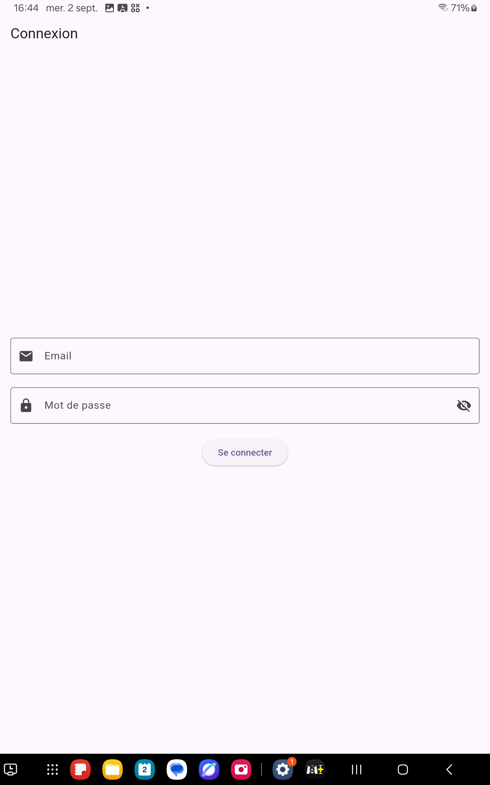
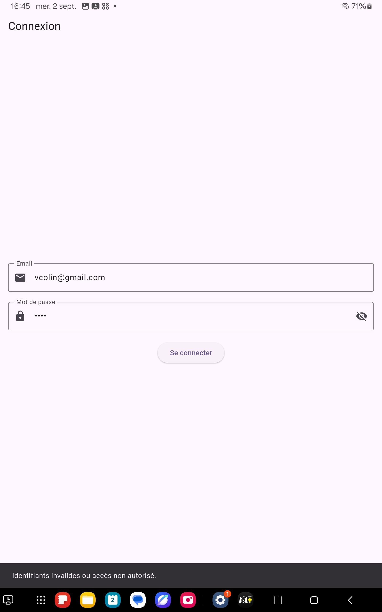
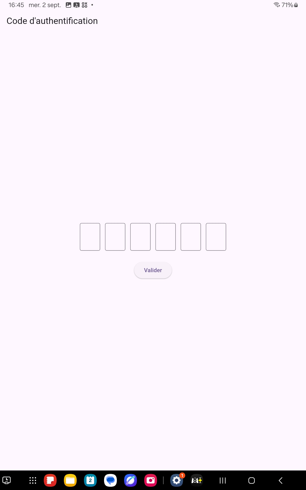
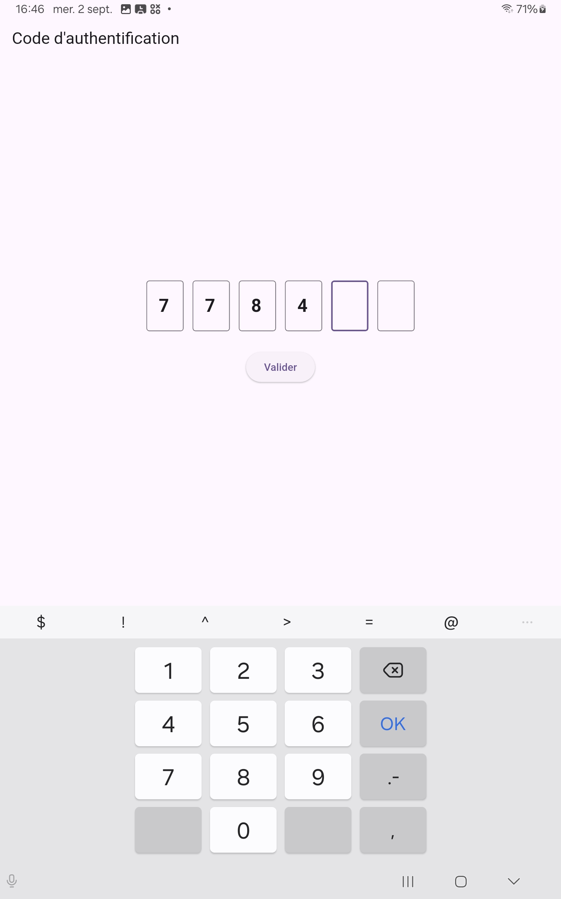
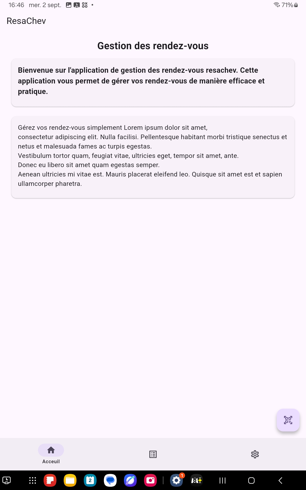
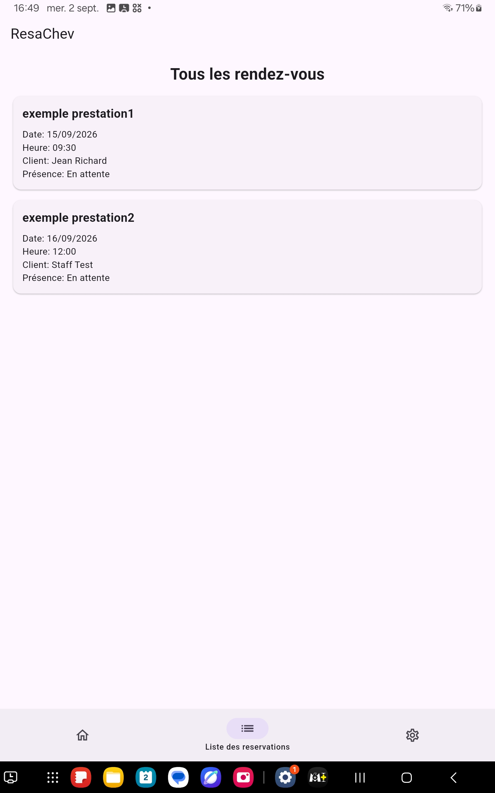
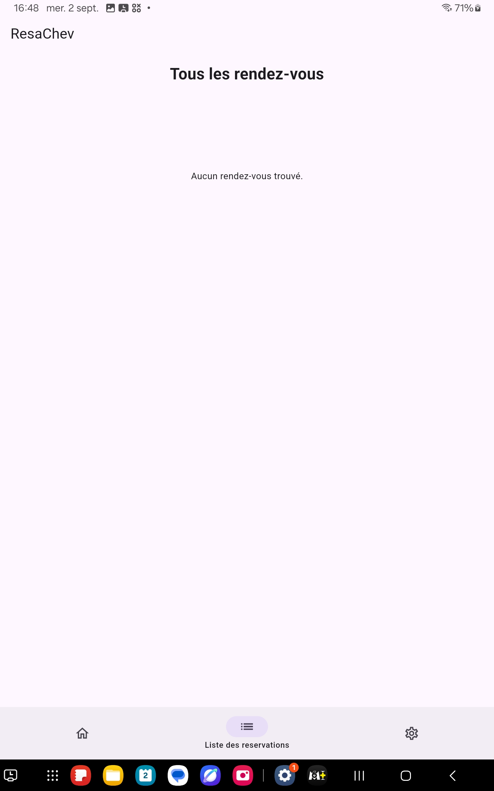
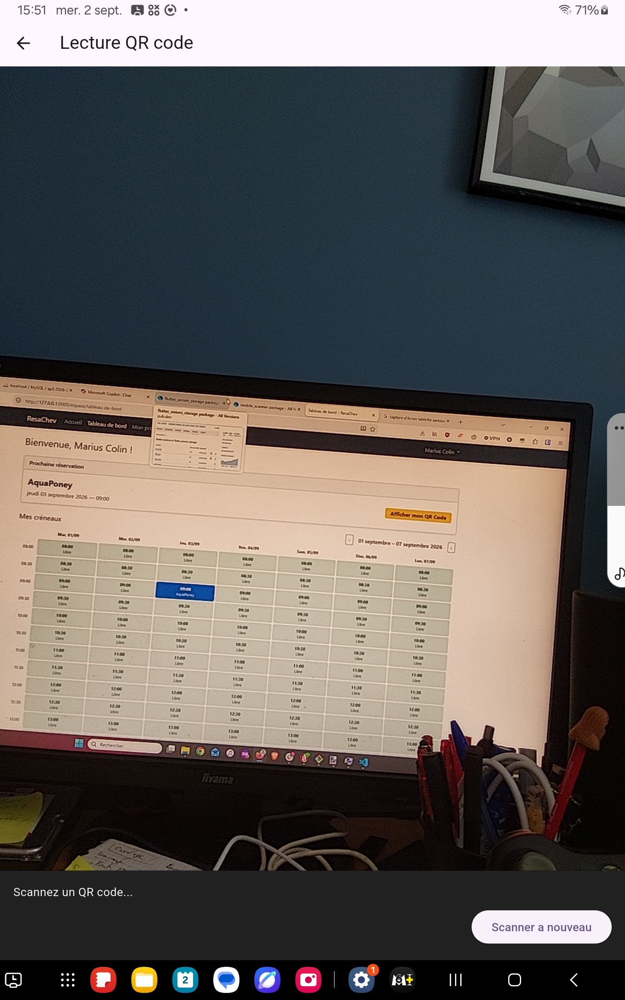
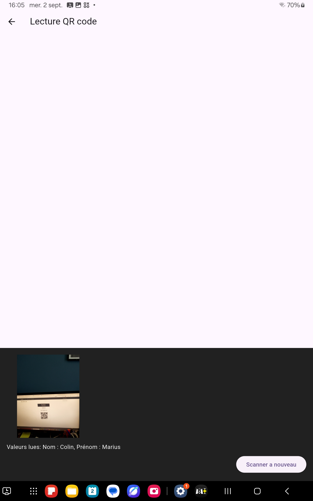
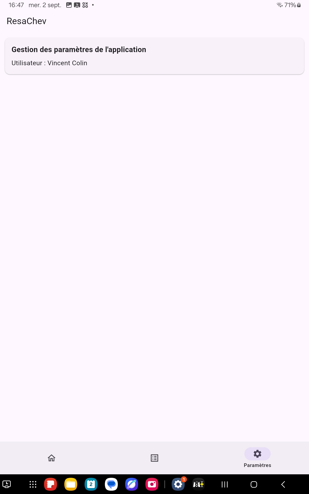

<div class="couverture">
<div class="bandeau">
<div class="sur">Dossier de spécifications</div>

# ResaChev - Application mobile

<div class="sous">Spécifications fonctionnelles et techniques</div>
</div>

<div class="cartouche">
<table class="cartouche-tbl">
<tr><th>Projet</th><td>AP3 - ResaChev, plateforme libre de réservation de créneaux (version 1.0)</td></tr>
<tr><th>Commanditaire</th><td>1FOSIO, société de prestation informatique - Direction des systèmes d'information</td></tr>
<tr><th>Maîtrise d'œuvre</th><td>Valentin Brosseau, Carine Autret</td></tr>
<tr><th>Composant</th><td>Application mobile pour le staff terrain (dépôt <code>mobile</code>)</td></tr>
<tr><th>Type de document</th><td>Spécifications fonctionnelles détaillées (SFD) et spécifications techniques détaillées (STD) - document d'introduction</td></tr>
<tr><th>Technologies</th><td>Flutter · Dart · Material 3 · API REST · Laravel Sanctum · mobile_scanner</td></tr>
<tr><th>Auteur</th><td>Valentin Brosseau, Carine Autret, Vincent Colin</td></tr>
<tr><th>Version</th><td>1.2</td></tr>
<tr><th>Statut</th><td>Validé</td></tr>
<tr><th>Diffusion</th><td>Équipes de développement 1FOSIO, maîtrise d'œuvre, clients finaux</td></tr>
</table>
</div>

<div class="versions">
<h4>Historique des versions</h4>
<table class="versions-tbl">
<tr><th>Version</th><th>Auteur</th><th>Modifications</th></tr>
<tr><td>1.0</td><td>Valentin Brosseau, Carine Autret, Vincent Colin</td><td>Rédaction initiale : présentation, fonctionnalités, captures d'écran, architecture technique.</td></tr>
<tr><td>1.1</td><td>Valentin Brosseau, Carine Autret, Vincent Colin</td><td>Mise à jour après réinitialisation du projet Android : jeton en stockage sécurisé, résolution du QR code par l'API, écran Paramètres alimenté, mise à jour des versions et des points de vigilance.</td></tr>
<tr><td>1.2</td><td>Valentin Brosseau, Carine Autret, Vincent Colin</td><td>Rétablissement des permissions Android <code>INTERNET</code> et <code>CAMERA</code> ; exclusion du dossier <code>linux/</code> de l'analyse statique et enregistrement des greffons de la cible Linux ; dettes de réinitialisation restantes ramenées à trois (trafic en clair, <code>NSCameraUsageDescription</code>, <code>env.prod.json</code>).</td></tr>
</table>
</div>
</div>

[[TOC]]

## 1. Introduction

### L'essentiel

1. **ResaChev** est une plateforme libre de réservation de créneaux développée par 1FOSIO ; ce dépôt est son **application mobile**, destinée au **staff terrain** qui accueille les clients.
2. Elle est développée en **Flutter / Dart** et fonctionne sur Android et iOS à partir d'un **code source unique**.
3. Elle n'accède **jamais directement** à la base de données : toutes ses données transitent par l'**API mobile** de l'application web, protégée par des jetons **Laravel Sanctum**.
4. L'accès est réservé aux comptes de **rôle staff** et passe par une **double authentification** : identifiants, puis code à six chiffres reçu par email.
5. Une fois connecté, le staff consulte la **liste des rendez-vous à venir** et dispose d'un **lecteur de QR code**.
6. Le QR code présenté par le client est désormais **résolu auprès de l'API** : l'application affiche l'identité du client rattaché à la réservation scannée. En revanche, la **validation de la présence** n'est toujours pas transmise au serveur : c'est l'évolution prioritaire.
7. Le code suit un découpage en trois couches : `screens/` (présentation) → `services/` (accès aux données) → `models/` (objets métier).
8. La navigation repose sur une **coquille unique** à barre de navigation basse, dans laquelle s'échangent trois onglets.
9. Le jeton d'authentification est conservé dans le **stockage sécurisé** de l'appareil (Keystore Android / Keychain iOS).

### 1.1 Objet du document

Ce document présente **ResaChev**, la solution libre de réservation de créneaux développée par la société de prestation informatique **1FOSIO**, et plus précisément son **application mobile** : l'outil du personnel de terrain, utilisé au comptoir ou sur le lieu de la prestation pour consulter les rendez-vous à venir et valider l'arrivée des clients. Il décrit l'existant (version 1.0) qui sert de **socle technique commun** aux déclinaisons réalisées pour chaque client final. Il tient lieu à la fois de spécification fonctionnelle (ce que fait l'application, pour qui, avec quelles règles) et de spécification technique d'introduction (comment elle est construite, avec quelles technologies et quelle organisation du code).

Il s'adresse à un lecteur qui découvre le projet : chaque fonctionnalité est illustrée par une capture d'écran commentée, et la partie technique s'appuie sur les notions vues en cours (programmation orientée objet, programmation asynchrone, consommation d'une API REST, sérialisation JSON, séparation en couches). La documentation détaillée du code se trouve dans les autres fichiers du dossier `doc/`.

### 1.2 Contexte et organisation

De nombreux secteurs d'activité (bien-être, sport, santé, coworking, loisirs…) sont confrontés au même besoin : moderniser une gestion des réservations encore souvent artisanale (tableur, papier, téléphone). Ces structures cherchent des solutions numériques fiables, rapides à mettre en place et adaptées à leur métier.

C'est dans ce contexte que **1FOSIO** a développé ResaChev, une solution libre de réservation conçue pour être **déclinée** selon les besoins de chaque client. Plutôt que de repartir de zéro pour chaque projet, la DSI de 1FOSIO a fait le choix de s'appuyer sur ResaChev comme socle technique commun, à personnaliser et enrichir selon le contexte de chaque client final.

La solution est composée de **trois applications** qui partagent une même base de données :

| Application | Technologie | Utilisateur | Rôle |
|---|---|---|---|
| Interface web | PHP / Laravel | Client | Consulter ses réservations, présenter son QR code — et exposer l'API mobile |
| Application de gestion | C# / .NET / WinForms | Administrateur | Gérer les comptes et les réservations |
| **Application mobile** (ce document) | Flutter | Staff terrain | Consulter les rendez-vous, scanner les QR codes |

Le choix d'une **application mobile** pour le staff se justifie par l'usage : le personnel de terrain est debout, en déplacement, et doit accéder d'une main à la liste du jour puis dégainer un lecteur de QR code. Aucun poste fixe ne répond à ce besoin. Le choix de **Flutter** ajoute qu'un seul code source alimente Android et iOS, ce qui divise par deux l'effort de développement et de maintenance pour une équipe réduite.

### 1.3 L'existant (version 1.0)

L'application est développée en Dart avec Flutter et l'habillage **Material 3**. Elle s'ouvre sur un écran de connexion en deux temps (identifiants puis code de vérification reçu par email), puis présente une coquille à trois onglets : un **accueil** portant le bouton d'accès au lecteur de QR code, la **liste des rendez-vous** à venir rafraîchissable d'un balayage, et un écran de **paramètres** affichant l'identité du staff connecté. La lecture du QR code fonctionne : la caméra s'ouvre, le code est décodé une seule fois, son contenu — l'identifiant de la réservation — est **envoyé à l'API**, qui retourne le client attendu ; l'image analysée est affichée à côté du résultat. En revanche, l'application **ne transmet toujours pas la validation de présence** à l'API. L'accès aux données repose entièrement sur l'API mobile et sur un jeton Sanctum conservé dans le stockage sécurisé de l'appareil.

Le projet Android a été **réinitialisé** après une mise à jour de Flutter : cette opération a fait repartir les fichiers natifs de leur version générée par défaut, et **supprimé au passage des déclarations indispensables** (permissions `INTERNET` et `CAMERA`, autorisation du trafic en clair, description d'usage de la caméra sur iOS), ainsi que le contenu de `env.prod.json`. Les deux **permissions Android ont depuis été rétablies** ; trois dettes subsistent — l'autorisation du trafic en clair, la description d'usage de la caméra sur iOS et les URL de production — et leur rétablissement reste le préalable à toute livraison (voir les sections 3.6 et 4.6).

### 1.4 Périmètre de ce document

<p class="intertitre"><strong>Dans le périmètre (application mobile, ce dépôt) :</strong></p>

- connexion du staff en deux étapes et conservation du jeton sur l'appareil ;
- navigation générale : coquille unique et barre de navigation à trois onglets ;
- écran d'accueil et accès au lecteur de QR code ;
- liste des rendez-vous à venir, avec rafraîchissement par balayage ;
- lecture d'un QR code par la caméra et résolution de l'identifiant auprès de l'API ;
- affichage de l'identité du staff connecté dans l'écran des paramètres ;
- consommation de l'API mobile et organisation du code en couches.

**Hors périmètre** : l'espace client du site web et la génération du QR code, l'implémentation côté serveur de l'API mobile (décrite dans `doc/api-mobile.md` du dépôt web), l'application de gestion, la gestion des paiements et l'administration des prestations. Les évolutions demandées par 1FOSIO ne sont pas décrites ici : ce document est le point de départ de leur analyse.

### 1.5 Acteurs

| Acteur | Description | Accès dans ce projet |
|---|---|---|
| **Staff** (`role` = staff) | Personnel de terrain accueillant les clients | Toutes les fonctions de l'application mobile |
| **Client** (`role` = client) | Personne ayant réservé une prestation | Aucun : il présente son QR code, il n'utilise pas l'application |
| **Administrateur** | Personnel administratif de la structure | Aucun : il utilise l'application de gestion |

> **Point de vigilance.** L'API n'accepte que les comptes de rôle staff : un client qui installerait l'application ne pourrait pas se connecter. Le contrôle est fait **côté serveur**, ce qui est le bon endroit — une application mobile est distribuée sur des appareils que l'on ne maîtrise pas et ne peut jamais être considérée comme un rempart.

### 1.6 Glossaire

| Terme | Définition |
|---|---|
| **Flutter** | Cadriciel (*framework*) de Google permettant de construire, à partir d'un code Dart unique, des applications Android, iOS, web et desktop. |
| **Dart** | Langage de programmation employé par Flutter : orienté objet, typé, avec gestion native de l'asynchrone. |
| **Widget** | Brique élémentaire d'une interface Flutter. Tout est widget : un texte, un bouton, une marge, un écran entier. |
| **`StatefulWidget` / `State`** | Widget dont l'apparence dépend de données susceptibles de changer ; `setState()` signale un changement et déclenche la reconstruction. |
| **`build()`** | Méthode qui décrit l'interface sous forme d'arbre de widgets. Elle peut être appelée très souvent : elle ne doit contenir aucun traitement coûteux. |
| **`Future` / `async` / `await`** | Mécanisme de programmation asynchrone. Un `Future` est une valeur qui arrivera plus tard (réponse réseau, lecture de fichier) ; `await` attend cette valeur sans figer l'interface. |
| **`FutureBuilder`** | Widget qui reconstruit son contenu à chaque changement d'état d'un `Future` : en cours, en erreur, terminé. |
| **API REST** | Interface d'accès aux données par des requêtes HTTP (`GET`, `POST`) et des réponses JSON. |
| **JSON** | Format d'échange de données textuel, converti en objets Dart par `jsonDecode()` et les constructeurs `fromJson`. |
| **Jeton (*token*)** | Chaîne secrète remise après authentification et rejouée à chaque requête (`Authorization: Bearer …`) pour prouver son identité. |
| **Sanctum** | Composant de Laravel qui émet et vérifie ces jetons côté serveur. |
| **2FA** | *Two-Factor Authentication* : authentification à deux facteurs, ici mot de passe puis code à usage unique reçu par email. |
| **Stockage sécurisé** | Espace clé/valeur chiffré par le système (Keystore Android, Keychain iOS), exposé en Flutter par le paquet `flutter_secure_storage` ; il conserve ici le jeton. |
| **QR code** | Code-barres à deux dimensions, lu par la caméra ; il porte ici l'identifiant de la réservation du client. |
| **Mail catcher** | Faux serveur SMTP qui intercepte tous les emails au lieu de les délivrer ; il reçoit les codes de vérification. |
| **Hot reload** | Rechargement à chaud du code dans l'application en cours d'exécution, sans perdre l'état : atout majeur de Flutter en développement. |

## 2. Spécifications fonctionnelles

Cette partie décrit chaque fonctionnalité du point de vue de l'utilisateur. Les captures d'écran sont réalisées sur un jeu de données de démonstration ; elles reflètent l'état réel de l'application.

### 2.1 Connexion du staff

<div class="figures">
<div>


<p class="legende"><strong>Figure 1</strong> : Écran de connexion, premier écran au lancement.</p>

</div>
<div>


<p class="legende"><strong>Figure 2</strong> : Message affiché lorsque les identifiants sont refusés.</p>

</div>
</div>

L'application s'ouvre sur la saisie de l'adresse email et du mot de passe. Le mot de passe est masqué, avec une icône permettant de l'afficher le temps de vérifier la frappe — geste utile sur un clavier tactile. Le clavier proposé pour l'adresse email comporte directement l'arobase et le point.

Si un champ est vide, un message le signale sans qu'aucune requête ne soit envoyée. Si le serveur refuse les identifiants — mot de passe erroné, ou compte qui n'est **pas de rôle staff** — le message renvoyé par l'API est affiché tel quel, en bas de l'écran. La saisie est conservée.

<div class="figures">
<div>


<p class="legende"><strong>Figure 3</strong> : Saisie du code de vérification reçu par email.</p>

</div>
<div>


<p class="legende"><strong>Figure 4</strong> : Saisie en cours : clavier numérique et passage automatique au champ suivant.</p>

</div>
</div>

Les identifiants acceptés, l'application n'ouvre pas encore la session : le serveur envoie un **code à six chiffres par email** et l'écran de vérification s'affiche. Le code se saisit dans six cases, le curseur passant automatiquement à la suivante ; seuls les chiffres sont acceptés. Une fois le code validé, le serveur remet un jeton d'authentification, conservé **chiffré** sur l'appareil, et l'application s'ouvre. Un code erroné ou expiré est signalé sans quitter l'écran.

Cette double vérification protège un accès sensible : l'application mobile permet de consulter le nom des clients attendus et, à terme, de valider leur présence.

| Règle | Description |
|---|---|
| RG-AUTH-1 | Seuls les comptes de rôle **staff** peuvent se connecter. |
| RG-AUTH-2 | La connexion se déroule en deux étapes : identifiants, puis code reçu par email. |
| RG-AUTH-3 | Le jeton n'est délivré qu'après validation du code, puis conservé dans le stockage sécurisé de l'appareil. |
| RG-AUTH-4 | Les six chiffres sont obligatoires et la saisie n'accepte que des chiffres. |
| RG-AUTH-5 | Le code est invalidé après usage ; une seule session est active par compte. |

### 2.2 Accueil et navigation


<p class="legende"><strong>Figure 5</strong> : Accueil, avec le bouton d'accès au lecteur de QR code.</p>

Une fois connecté, le staff arrive sur un écran d'accueil présentant l'application. Une **barre de navigation basse** donne accès à trois onglets : accueil, liste des rendez-vous et paramètres. Elle reste visible en permanence, l'onglet actif étant seul à afficher son libellé, afin de dégager de la place à l'écran.

Le **bouton flottant** en bas à droite ouvre le lecteur de QR code : c'est l'action la plus fréquente du staff, placée là où le pouce l'atteint sans effort.

Ouvrir un onglet remplace le contenu de l'écran sans quitter la coquille ; l'accès à la liste des rendez-vous est refusé si aucun jeton valide n'est présent.

| Règle | Description |
|---|---|
| RG-NAV-1 | Un seul onglet est affiché à la fois, la barre de navigation restant visible. |
| RG-NAV-2 | La liste des rendez-vous n'est accessible qu'avec un jeton d'authentification. |
| RG-NAV-3 | Le lecteur de QR code s'ouvre par-dessus l'application ; la flèche « retour » ramène à l'accueil. |

### 2.3 Liste des rendez-vous

<div class="figures">
<div>


<p class="legende"><strong>Figure 6</strong> : Rendez-vous à venir, une carte par réservation.</p>

</div>
<div>


<p class="legende"><strong>Figure 7</strong> : Aucun rendez-vous à afficher.</p>

</div>
</div>

L'onglet des rendez-vous interroge l'API et présente une **carte par réservation** : prestation, date, heure, nom et prénom du client, et état de la validation de présence. Les rendez-vous couvrent la journée en cours et les jours suivants, triés par date puis par heure croissantes, de sorte que le prochain client attendu figure en tête de liste.

Pendant le chargement, un indicateur de progression tourne au centre de l'écran. Un **balayage vers le bas** relance l'interrogation : c'est le geste attendu sur mobile, l'équivalent d'un bouton « rafraîchir » sur poste fixe.

Lorsqu'aucun rendez-vous n'est retourné, un message l'indique explicitement plutôt que de laisser un écran vide, et le balayage de rafraîchissement reste disponible.

Une donnée absente n'empêche jamais l'affichage : la carte indique « Prestation non précisée », « Non définie » ou « Non renseigné » selon le champ manquant.

| Règle | Description |
|---|---|
| RG-RDV-1 | La liste présente les réservations à partir d'aujourd'hui, triées par date puis heure croissantes. |
| RG-RDV-2 | Un balayage vers le bas rafraîchit la liste. |
| RG-RDV-3 | L'état de présence est affiché en clair : « Validée » ou « En attente ». |
| RG-RDV-4 | Une donnée absente est remplacée par un libellé de repli, jamais par une erreur. |

### 2.4 Lecture du QR code

<div class="figures">
<div>


<p class="legende"><strong>Figure 8</strong> : Lecteur de QR code, caméra active.</p>

</div>
<div>


<p class="legende"><strong>Figure 9</strong> : Résultat de la lecture : image analysée, identité du client et bouton de relance.</p>

</div>
</div>

Le lecteur ouvre la caméra en plein écran, avec un bandeau d'information en bas. Le client présente le QR code affiché dans son espace web ; la lecture est immédiate.

Un code n'est lu **qu'une seule fois** : dès la détection, la caméra s'éteint, l'**image analysée** s'affiche dans le bandeau, et l'identifiant lu est envoyé à l'API. Celle-ci retourne la réservation correspondante, dont le **nom et le prénom du client** apparaissent à l'écran : l'opérateur vérifie ainsi immédiatement qu'il a bien devant lui la personne attendue. Le bouton « Scanner a nouveau » relance la caméra pour le client suivant.

C'est l'évolution principale de cette version : le contenu du QR code n'est plus interprété localement — l'application attendait auparavant un texte de la forme « Nom : … Prénom : … Date : … Heure : … », que le site web ne produit pas — mais traité comme l'**identifiant de la réservation**, seule donnée que le site encode réellement. L'identité affichée provient donc de la base, non du billet présenté. Si l'identifiant est inconnu du serveur, le bandeau indique « Réservation ou utilisateur introuvable. » et aucune action n'est déclenchée.

Le lecteur n'est proposé que sur **Android** : sur toute autre plateforme, l'écran affiche un message invitant à utiliser un smartphone plutôt que de tenter d'ouvrir un périphérique absent.

> **Point de vigilance — fonctionnalité à terminer.** À ce stade, le scan **identifie** le client mais ne **valide** pas sa présence : rien n'est renvoyé au serveur, et le badge « Présence validée » de l'espace client reste inchangé. C'est l'évolution prioritaire de l'application (voir la section 2.6). La **permission caméra**, supprimée par la réinitialisation du projet Android, a en revanche été rétablie : le lecteur fonctionne de nouveau hors du poste de développement sur Android — mais pas sur iOS, dont le `Info.plist` ne déclare toujours pas l'usage de la caméra.

| Règle | Description |
|---|---|
| RG-SCAN-1 | Un QR code n'est lu qu'une fois ; la caméra s'éteint après la lecture. |
| RG-SCAN-2 | Le lecteur n'est proposé que sur Android. |
| RG-SCAN-3 | Le contenu du QR code est traité comme l'identifiant de la réservation et résolu auprès de l'API. |
| RG-SCAN-4 | Un identifiant inconnu affiche « Réservation ou utilisateur introuvable. » et ne déclenche aucune action. |
| RG-SCAN-5 | L'image analysée par la caméra est affichée à côté du résultat. |
| RG-SCAN-6 | Le bouton « Scanner a nouveau » relance la caméra sans quitter l'écran. |

### 2.5 Paramètres


<p class="legende"><strong>Figure 10</strong> : Écran des paramètres, avec l'identité du staff connecté.</p>

Le troisième onglet affiche désormais l'**identité du staff connecté** : à l'ouverture, l'application interroge l'API et remplace le message « Chargement des informations... » par le prénom et le nom de l'utilisateur du jeton. Il reste à y ajouter la version de l'application et, surtout, le **bouton de déconnexion** — toujours absent, alors que la fonction correspondante existe déjà dans le code.

> **Point de vigilance.** Si l'API est injoignable ou le jeton expiré, l'écran reste indéfiniment sur « Chargement des informations... » : l'échec n'est pas distingué de l'attente.

### 2.6 Récapitulatif des fonctionnalités

| Réf. | Fonctionnalité | Acteur | Statut |
|---|---|---|---|
| F1 | Connexion par identifiants | Staff | Livré |
| F2 | Double authentification par code reçu par email | Staff | Livré |
| F3 | Conservation du jeton sur l'appareil | Staff | Livré |
| F4 | Coquille de navigation à trois onglets | Staff | Livré |
| F5 | Écran d'accueil et accès au lecteur de QR code | Staff | Livré |
| F6 | Liste des rendez-vous à venir | Staff | Livré |
| F7 | Rafraîchissement de la liste par balayage | Staff | Livré |
| F8 | Lecture d'un QR code par la caméra | Staff | Livré |
| F9 | **Validation de la présence du client après scan** | Staff | **Évolution prioritaire** |
| F10 | Alignement du format du QR code sur celui du site web | Staff | Livré |
| F11 | Identification du client rattaché à la réservation scannée | Staff | Livré |
| F12 | Affichage du profil du staff connecté | Staff | Livré |
| F13 | Conservation du jeton dans le stockage sécurisé de l'appareil | Staff | Livré |
| F14 | Rétablissement des permissions Android `INTERNET` et `CAMERA` | — | Livré |
| F14b | **Rétablissement des déclarations natives restantes** (trafic en clair, `NSCameraUsageDescription`, `env.prod.json`) | — | **Évolution prioritaire** |
| F15 | Bouton de déconnexion | Staff | Évolution prioritaire |
| F16 | Reconnexion automatique si le jeton est toujours valide | Staff | Évolution |
| F17 | Filtre sur la seule journée du jour | Staff | Évolution |
| F18 | Prise en charge du lecteur de QR code sur iOS | Staff | Évolution |
| F19 | Basculement développement / production sans recompilation | — | Évolution |

## 3. Spécifications techniques

### 3.1 Stack technique

| Couche | Technologie | Justification |
|---|---|---|
| Langage | Dart (SDK `^3.13.2`) | Langage de Flutter : typé, orienté objet, asynchrone natif (`Future`, `async`/`await`) |
| Cadriciel | Flutter, Material 3 | Un seul code source pour Android et iOS ; *hot reload* en développement |
| Interface | Widgets standards (`Scaffold`, `NavigationBar`, `Card`, `FutureBuilder`) | Aucune bibliothèque d'interface tierce : chaque comportement reste lisible dans le code du projet |
| Accès aux données | `http` vers l'API mobile Laravel | Le serveur reste seul responsable des règles métier et de la base |
| Authentification | Jeton Laravel Sanctum, en-tête `Bearer` | Standard des API REST ; jeton révocable côté serveur |
| Stockage local | `flutter_secure_storage` | Conservation du jeton chiffré par le système (Keystore Android, Keychain iOS) |
| Caméra / QR | `mobile_scanner` (^6.0.11) | Paquet de référence, maintenu ; version figée après la réinitialisation du projet Android |
| Configuration | Fichier JSON dans les assets | Flutter ne lit pas les fichiers `.env` ; le JSON embarqué en tient lieu |

Aucune bibliothèque de gestion d'état tierce : l'état est porté par les `StatefulWidget` et `setState()`, ce qui suffit à la taille de l'application.

### 3.2 Architecture en couches

L'application applique une séparation **présentation / accès aux données / modèles**, transposition à Flutter du découpage retenu pour l'application de gestion :

```
   screens/ + widgets/ (présentation)        services/ (accès données)          API web (Laravel)
 ┌────────────────────────────────┐      ┌──────────────────────────┐      ┌──────────────────┐
 │ LoginUtilisateur, TwoFaUser,   │ ───▶ │ UsrApi                   │ ───▶ │ /api/mobile/…    │──▶ MySQL
 │ PageLogP, Accueil,             │      │ ReservationApi           │      │ (Sanctum)        │
 │ Affichagerdv, QrScannerScreen  │ ◀─── │ GestionToken · AppConfig │ ◀─── │                  │
 └────────────────────────────────┘      └──────────────────────────┘      └──────────────────┘
              │                                       │
              └──▶ models/ (User, Reservation) ◀──────┘
```

**Les écrans** (`screens/`) affichent les données et réagissent aux gestes. Ils ne construisent **aucune URL** et ne manipulent **aucun JSON** : ils appellent les services et exploitent le résultat.

**Les widgets** (`widgets/`) sont les composants réutilisés par plusieurs écrans : barre du haut et barre de navigation basse.

**Les services** (`services/`) contiennent les appels HTTP, la lecture de la configuration et la gestion du jeton. Chaque méthode capture les exceptions et retourne une valeur neutre, de sorte que l'écran appelant reste simple.

**Les modèles** (`models/`) sont des classes de données immuables, avec leur constructeur `fromJson`. Ils ne dépendent pas de Flutter et pourraient être testés seuls.

**Pourquoi ces choix techniques ?** Plusieurs partis pris ont une raison pédagogique : la couche `services/` est **isolée** plutôt que d'appeler `http` depuis les écrans, afin que la séparation des responsabilités soit visible ; les modèles sont **écrits à la main** plutôt que générés (`json_serializable`), pour que la conversion JSON → objet reste lisible et que les conversions de format (date française, heure) soient explicites ; enfin l'interface s'appuie uniquement sur les **widgets standards**, pour que chaque comportement reste compréhensible dans le code du projet.

### 3.3 Organisation des dossiers

```
mobile/
├── pubspec.yaml                  Dépendances, version, déclaration des assets
├── analysis_options.yaml         Règles de lint (flutter_lints ; dossiers natifs exclus)
├── assets/env.dev.json           URL de l'API en développement
├── assets/env.prod.json          URL de l'API en production
├── android/ ios/ web/ …          Projets natifs générés par Flutter
├── test/                         Tests (non adaptés à ce jour)
├── doc/                          Documentation, captures, outils de génération
└── lib/
    ├── main.dart                 Point d'entrée : chargement de la config puis MaterialApp
    ├── models/                   User, Reservation (+ fromJson)
    ├── services/                 AppConfig, GestionToken, UsrApi, ReservationApi
    ├── screens/                  Un fichier par écran
    └── widgets/                  AppBarPrincipal, BottomNavbar
```

Contrairement à Windows Forms, **un écran tient dans un seul fichier** : il n'y a ni code généré par un concepteur visuel, ni fichier de ressources. L'interface est décrite en code, dans la méthode `build()`.

### 3.4 Accès aux données par l'API

L'application ne possède **ni chaîne de connexion, ni pilote de base, ni SQL**. C'est une différence de nature avec l'application de gestion : le téléphone d'un membre du staff peut être perdu sans que la base soit exposée.

| Méthode | Route | Authentifiée | Usage |
|---|---|---|---|
| `POST` | `/api/mobile/login` | non | Vérifie les identifiants, déclenche l'envoi du code |
| `POST` | `/api/mobile/verify-2fa` | non | Vérifie le code, retourne le jeton |
| `GET` | `/api/mobile/rdv` | oui | Liste des réservations à partir d'aujourd'hui |
| `GET` | `/api/mobile/reservation/{id}/client` | oui | Réservation et client correspondant à l'identifiant scanné |
| `GET` | `/api/mobile/me` | oui | Profil du staff connecté (écran Paramètres) |
| `POST` | `/api/mobile/valider-presence` | oui | **Non utilisée** : validation de la présence |

**Le jeton.** Après validation du code, le jeton est enregistré dans le stockage sécurisé sous la clé `auth_token`, puis rejoué à chaque requête protégée :

```dart
headers: {
  'Content-Type': 'application/json; charset=UTF-8',
  'accept': 'application/json',
  'Authorization': 'Bearer $token',
}
```

**La conversion JSON.** Les réponses sont converties en objets métier par les constructeurs `fromJson`, qui prennent en charge les formats propres à cette API — date française, heure sans date, nom de clé ayant changé au fil des versions :

```dart
final utilisateurOuClient = json['utilisateur'] ?? json['client'];   // deux noms acceptés

return listeBrute
    .whereType<Map<String, dynamic>>()
    .map(Reservation.fromJson)
    .toList();
```

**Le traitement des erreurs.** Chaque service encapsule son appel dans un `try/catch` et borne l'attente par un `timeout` de 45 secondes. Les codes HTTP sont traduits en messages affichables, en privilégiant toujours le message renvoyé par le serveur.

| Code | Signification | Traitement |
|---|---|---|
| 200 | Succès | Poursuite du parcours |
| 401 | Identifiants, code ou jeton invalides | Message du serveur affiché |
| 422 | Données manquantes ou invalides | Message du serveur, ou texte par défaut |
| autre | Erreur serveur | `Erreur serveur (<code>)` |

### 3.5 Cycle de vie et navigation

```
main()
  │
  ├─ WidgetsFlutterBinding.ensureInitialized()
  ├─ AppConfig.load()                ← assets/env.dev.json → apiBaseUrl
  └─ runApp(MyApp) → MaterialApp(home: LoginUtilisateur)
        │
        ├─ POST /api/mobile/login ─────▶ TwoFaUser
        │                                   ├─ POST /api/mobile/verify-2fa
        │                                   └─ jeton enregistré ─▶ PageLogP
        │                                                            ├─ Accueil       ─▶ QrScannerScreen
        │                                                            │                     └─▶ GET /api/mobile/reservation/{id}/client
        │                                                            ├─ Affichagerdv  ─▶ GET /api/mobile/rdv
        │                                                            └─ ParamApp      ─▶ GET /api/mobile/me
```

La configuration est chargée **avant** la construction de l'interface : c'est le rôle de `await AppConfig.load()`, et la raison pour laquelle `main()` est asynchrone.

Deux mécanismes de navigation coexistent : le `Navigator` pour les changements d'écran complets (connexion, scanner), et l'**échange du corps de page** dans `PageLogP` pour les trois onglets — l'équivalent du `panelContent` de la fenêtre principale de l'application de gestion.

### 3.6 Sécurité

| Mesure | Situation dans le projet |
|---|---|
| Accès à la base de données | Couverte par conception : l'application n'accède jamais à MySQL, tout passe par l'API |
| Injection SQL | Sans objet côté mobile ; les requêtes sont construites côté serveur par Eloquent |
| Contrôle du rôle | Couvert **côté serveur** : l'API refuse tout compte qui n'est pas de rôle staff |
| Double authentification | Couverte : le jeton n'est émis qu'après validation d'un code à usage unique reçu par email |
| Session unique | Couverte : l'API révoque les jetons antérieurs à chaque nouvelle connexion |
| Stockage du jeton | Couvert : le jeton est confié à `flutter_secure_storage`, donc chiffré par le Keystore Android ou le Keychain iOS — il n'est plus lisible en clair sur un appareil *rooté* |
| **Transport** | **Point de vigilance** : les URL restent en `http://` ; mot de passe, code et jeton circulent en clair sur le réseau |
| Permissions Android | Couverte depuis le 3 septembre 2026 : `android.permission.INTERNET` et `android.permission.CAMERA`, supprimées par la réinitialisation, sont de nouveau déclarées dans le manifeste — la compilation *release* émet des requêtes et ouvre la caméra |
| **Déclarations natives restantes** | **Point de vigilance** : le manifeste Android ne déclare toujours pas `usesCleartextTraffic`, et le `Info.plist` iOS pas la description d'usage de la caméra. Le premier bloque tout appel en `http://` depuis Android 9, le second fait rejeter l'application à l'ouverture de la caméra sur iOS |
| **Déconnexion** | **Point de vigilance** : aucune commande de déconnexion n'est exposée ; le jeton reste sur l'appareil |
| **Expiration du jeton** | **Point de vigilance** : un jeton révoqué n'est pas détecté ; l'application affiche une liste vide, ou un chargement sans fin dans les paramètres, au lieu de renvoyer vers la connexion |
| Confidentialité des données | L'application affiche des noms de clients : l'appareil doit être verrouillé et ne pas être prêté |

Le passage au stockage sécurisé lève l'un des deux points bloquants relevés en version 1.0, et le rétablissement des permissions Android rend de nouveau la compilation *release* exploitable. Le second point bloquant — le **transport en clair** — demeure : le passage en HTTPS est le préalable à toute mise en production.

### 3.7 Tests

La version 1.0 ne comporte **pas de tests automatisés** : le fichier `test/widget_test.dart` est celui que génère `flutter create` et teste un compteur qui n'existe pas dans cette application — `flutter test` échoue donc en l'état. La validation est manuelle, à partir du scénario de recette suivant :

| # | Scénario | Résultat attendu |
|---|---|---|
| 1 | Lancer l'application | L'écran de connexion s'affiche |
| 2 | Valider avec un champ vide | Message « Veuillez remplir tous les champs » |
| 3 | Se connecter avec un compte **client** | Message de refus renvoyé par l'API |
| 4 | Se connecter avec un compte **staff** valide | L'écran de saisie du code s'affiche, l'email arrive dans le mail catcher |
| 5 | Saisir un code incomplet | Message « Veuillez saisir les 6 chiffres du code. » |
| 6 | Saisir un code erroné | Message « Code invalide ou expiré. » |
| 7 | Saisir le bon code | L'accueil s'affiche, la barre de navigation apparaît |
| 8 | Ouvrir l'onglet des rendez-vous | Indicateur de chargement, puis la liste triée par date et heure |
| 9 | Balayer la liste vers le bas | La liste est rechargée |
| 10 | Couper l'API puis rafraîchir | *(défaut connu)* « Aucun rendez-vous trouvé » au lieu d'un message d'erreur |
| 11 | Ouvrir l'onglet des paramètres | Le prénom et le nom du compte connecté s'affichent |
| 12 | Ouvrir le lecteur de QR code | La caméra s'ouvre (sur téléphone Android) ou un message d'indisponibilité s'affiche |
| 13 | Scanner le QR code d'un client | L'image lue s'affiche, suivie du nom et du prénom du client attendu |
| 14 | Scanner un QR code quelconque | « Réservation ou utilisateur introuvable. » |
| 15 | Scanner puis vérifier l'espace client | *(défaut connu)* la présence n'est **pas** validée : le badge du site web reste inchangé |

La mise en place de tests est une évolution attendue, à trois niveaux : **tests unitaires** sur les modèles (`Reservation.fromJson` face à une date française, une clé absente, un type inattendu), **tests unitaires** sur les services avec un client HTTP simulé (`package:http/testing.dart`), et **tests de widgets** sur les écrans de connexion.

## 4. Premier démarrage

### 4.1 Environnement mis à disposition

L'application mobile suppose que l'**application web est lancée** et que ses routes `/api/mobile/*` sont joignables depuis l'appareil : c'est elle qui détient la base de données et l'ensemble des règles métier. Une **plateforme e-mail de type mail catcher** intercepte les messages envoyés par les applications du projet : c'est elle qui reçoit les codes de vérification à six chiffres. Les adresses de ces services, du site existant et des dépôts Git figurent dans le descriptif du projet.

Un compte de **rôle staff** (`idrole = 2`) est indispensable ; il se crée depuis l'application de gestion ou par le jeu de données de démonstration de l'application web.

### 4.2 Prérequis sur le poste de développement

- **SDK Flutter** sur le canal stable (`flutter --version`), avec le SDK Dart `^3.13.2` ;
- **Android Studio** (ou VS Code avec les extensions Flutter et Dart), avec le **NDK `27.0.12077973`** et les *command-line tools* installés, ainsi qu'un **JDK 17** ;
- pour le scan : un **téléphone Android physique** — la lecture de QR code n'est proposée que sur Android ;
- l'**application web** ResaChev lancée (`php artisan serve`) et joignable ;
- le **mail catcher** `mail.dombtsig.local:1025`.

`flutter doctor` vérifie l'ensemble de la chaîne et signale ce qui manque.

### 4.3 Installation

Le projet est récupéré depuis Git ; les paquets ne sont pas versionnés et sont téléchargés à la première commande.

```bash
git clone <url-du-depot> mobile
cd mobile

flutter pub get     # télécharge http, flutter_secure_storage, mobile_scanner…
```

### 4.4 Lancement

```bash
flutter devices     # liste les appareils et émulateurs disponibles
flutter run         # compile et installe sur l'appareil sélectionné
```

L'adresse de l'API dépend de la cible :

| Cible | Adresse à utiliser |
|---|---|
| Téléphone physique | `http://<IP de la machine>:8000/api`, avec `php artisan serve --host=0.0.0.0` — **valeur actuelle de `env.dev.json`** (`http://192.168.1.17:8000/api`), à adapter à chaque poste |
| Émulateur Android | `http://10.0.2.2:8000/api` |
| Web / desktop | `http://127.0.0.1:8000/api` |

Si la connexion échoue systématiquement, les causes les plus fréquentes sont : application web non lancée, adresse d'API inadaptée à la cible ou périmée dans `env.dev.json`, trafic en clair refusé par Android faute de `usesCleartextTraffic`, ou compte utilisé qui n'est pas de rôle staff.

### 4.5 Commandes utiles

| Commande | Usage |
|---|---|
| `flutter doctor` | Vérifie l'installation de Flutter et des outils Android / iOS |
| `flutter pub get` | Installe les dépendances déclarées dans `pubspec.yaml` |
| `flutter run` | Lance l'application en mode développement (*hot reload* par `r`) |
| `flutter analyze` | Analyse statique du code selon les règles de `analysis_options.yaml` |
| `flutter test` | Exécute les tests du dossier `test/` |
| `flutter build apk --release` | Produit un APK installable |
| `flutter clean` | Supprime les artefacts de compilation en cas de comportement incohérent |

### 4.6 Dettes laissées par la réinitialisation du projet

La réinitialisation du dossier Android, consécutive à une mise à jour de Flutter, a fait repartir les fichiers natifs de leur version générée par défaut. Les deux permissions Android ont été rétablies depuis ; les éléments **barrés** ci-dessous sont soldés, les autres restent à rétablir avant toute livraison :

| Élément | Fichier | Conséquence tant qu'il manque |
|---|---|---|
| ~~`android.permission.INTERNET`~~ | `android/app/src/main/AndroidManifest.xml` | **Rétabli le 3 septembre 2026** |
| ~~`android.permission.CAMERA`~~ | idem | **Rétabli le 3 septembre 2026** |
| `android:usesCleartextTraffic="true"` | idem | Les URL en `http://` sont refusées par Android 9 et suivants |
| `NSCameraUsageDescription` | `ios/Runner/Info.plist` | Rejet de l'application par iOS à l'ouverture de la caméra |
| URL de production | `assets/env.prod.json` | Les trois clés sont vides : la bascule en production ne joint aucun serveur |

La génération de la cible **desktop Linux** a par ailleurs ajouté au dépôt `linux/flutter/generated_plugin_registrant.cc` et `generated_plugins.cmake`, qui enregistrent `flutter_secure_storage_linux` et la bibliothèque FFI `jni`. Ces fichiers sont produits par Flutter et ne se modifient pas à la main ; le dossier `linux/` est désormais exclu de l'analyse statique, au même titre que les autres dossiers natifs.
